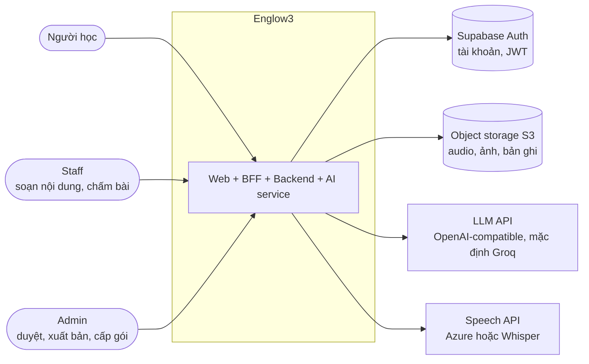
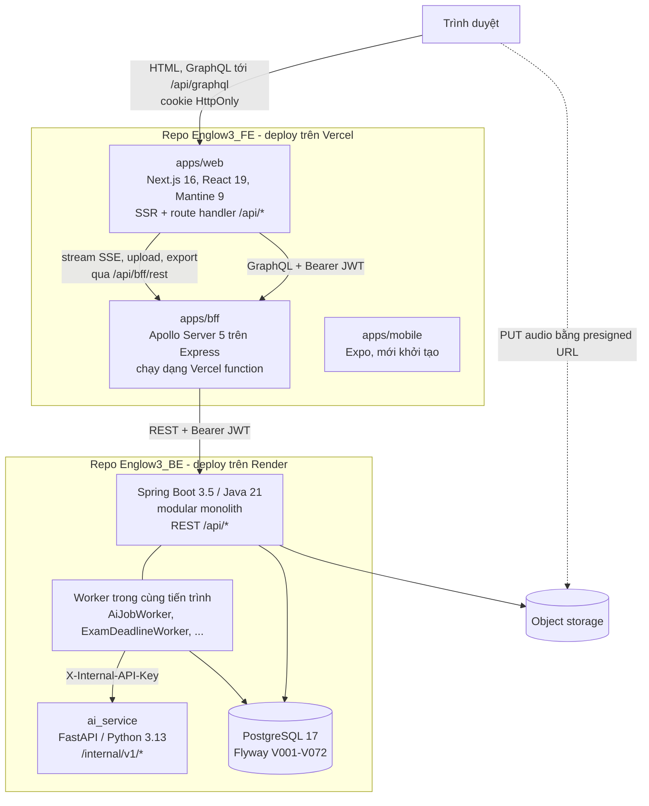
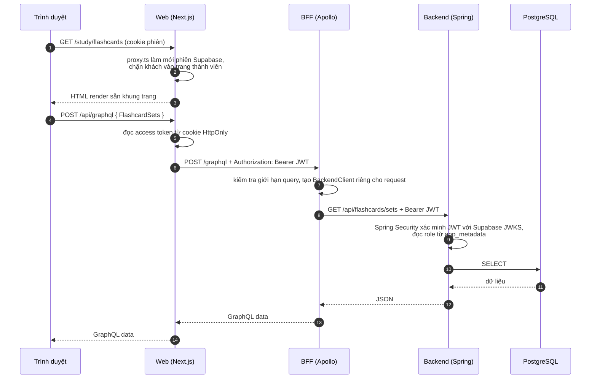

# 1. Kiến trúc tổng thể

## Ngữ cảnh hệ thống

Ai dùng hệ thống và hệ thống nói chuyện với những dịch vụ bên ngoài nào.

- **Supabase** giữ tài khoản, mật khẩu, đăng nhập Google/Facebook và phát JWT. Englow3 không tự quản mật khẩu.
- **Object storage** dùng chuẩn S3: MinIO khi chạy local, Supabase Storage hoặc R2 khi deploy. Có 4 bucket:
  `exams`, `learning`, `speaking` (riêng tư), `avatars` (công khai).
- **Nhà cung cấp AI** chỉ được gọi từ AI service, không bao giờ từ web, BFF hay trực tiếp từ module nghiệp vụ.

## Các thành phần

| Thành phần   | Công nghệ                                  | Trách nhiệm                                                                |
| ------------ | ------------------------------------------ | -------------------------------------------------------------------------- |
| `apps/web`   | Next.js App Router, Mantine, Apollo Client | Giao diện, phiên đăng nhập (cookie HttpOnly), proxy GraphQL, render server |
| `apps/bff`   | Apollo Server, Express                     | Ghép dữ liệu theo nhu cầu màn hình, chuyển lỗi backend thành lỗi GraphQL   |
| Backend      | Spring Boot, JPA, Flyway                   | Toàn bộ quy tắc nghiệp vụ, phân quyền, dữ liệu, hàng đợi AI                |
| `ai_service` | FastAPI, httpx                             | Adapter không trạng thái tới nhà cung cấp LLM, embedding, giọng nói        |
| PostgreSQL   | Postgres 17                                | Dữ liệu nghiệp vụ, hàng đợi `ai_jobs`, full-text search tài liệu gia sư    |

Nguyên tắc phân tầng, giữ ở cả hai repo:

1. **Quy tắc nghiệp vụ chỉ nằm ở backend**, trong entity khi có bất biến cần giữ. BFF và web không quyết định
   ai được làm gì hay bài làm được bao nhiêu điểm.
2. **Trình duyệt không bao giờ cầm token.** Token nằm trong cookie HttpOnly; route `/api/graphql` của web đọc
   cookie và thêm header `Authorization` trước khi gọi BFF.
3. **Web và mobile chỉ gọi BFF/Spring, không gọi thẳng AI service.** AI service chỉ nhận request có
   `X-Internal-API-Key` và không mở ra Internet.
4. **Mỗi bảng có đúng một module được ghi.** Module khác chỉ đọc qua interface `*.api` công khai hoặc qua truy
   vấn đọc-chỉ đã khai báo trong `docs/module-map.md`.

## Đường đi của một request

Ví dụ người học mở trang Flashcard:

Ba điểm đáng chú ý trên đường đi này:

- **Token chỉ tồn tại phía server.** Bước 5 và 6 xảy ra trong route handler của Next.js. Script trên trang (kể cả
  script bị chèn) không đọc được token.
- **BFF không giữ trạng thái.** Mỗi request tạo `BackendClient` mới mang token của chính request đó, nên không thể
  lẫn phiên giữa hai người dùng.
- **Backend tự xác minh JWT.** Backend không tin BFF; mọi endpoint đều kiểm tra chữ ký token và quyền.

## Việc chạy nền

Những việc không nằm trong một request đều chạy bằng `@Scheduled` trong tiến trình Spring, không có hệ thống
hàng đợi ngoài:

| Worker                      | Chu kỳ mặc định | Việc làm                                                               |
| --------------------------- | --------------- | ---------------------------------------------------------------------- |
| `AiJobWorker`               | 2 giây, 30 giây | Nhận job trong `ai_jobs`, gọi AI service, ghi kết quả; dọn job bị treo |
| `ExamDeadlineWorker`        | 10 giây         | Chốt và chấm bài thi đã hết giờ khi trình duyệt không còn nộp          |
| `TutorReplyReconciler`      | 30 giây         | Đồng bộ câu trả lời gia sư AI với trạng thái job                       |
| `TutorRecordingMaintenance` | 5 phút, 1 giờ   | Xoá bản ghi âm gia sư quá 24 giờ, dọn file theo yêu cầu xoá            |
| `SpeakingUploadCleanup`     | 1 giờ           | Dọn lượt luyện phát âm mở ra nhưng không bao giờ upload audio          |

Chi tiết hàng đợi AI xem [6. AI](06-ai.md).
