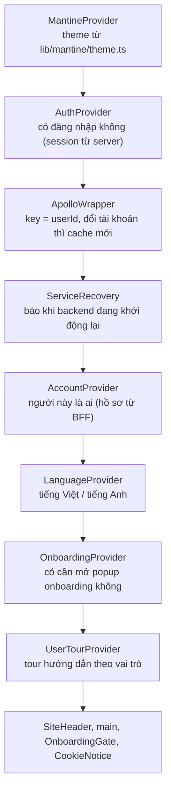
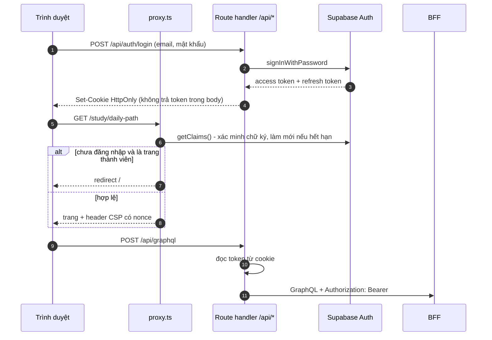
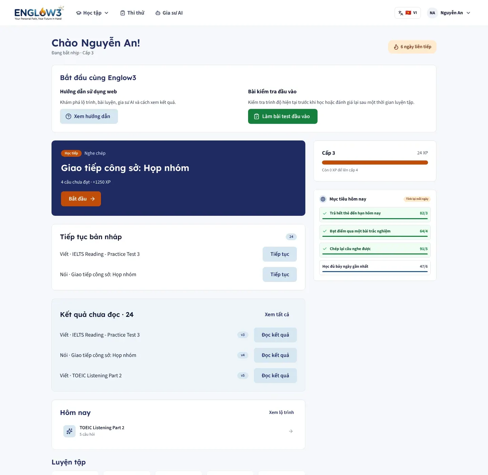
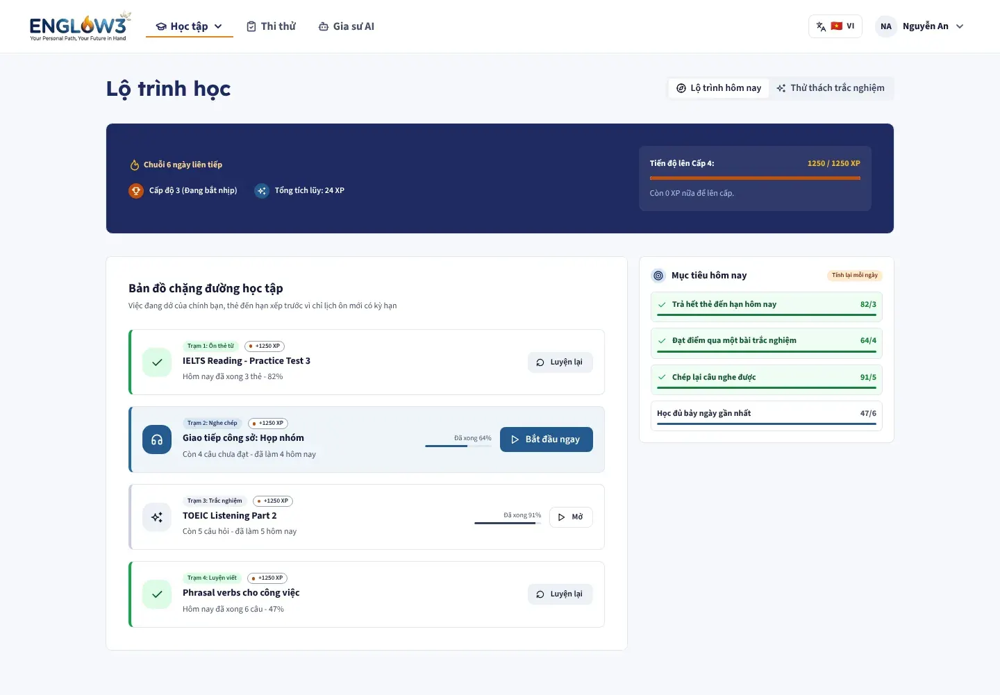
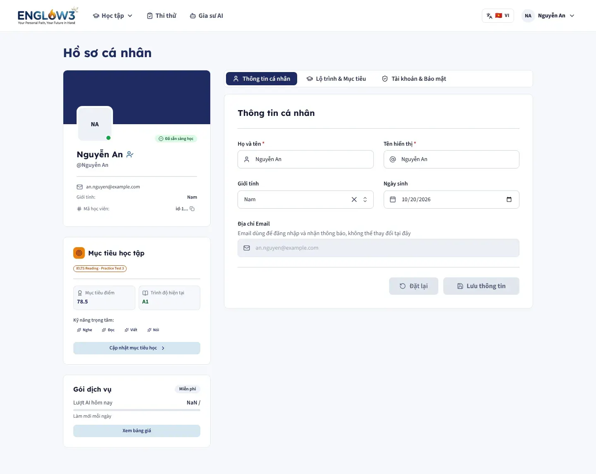
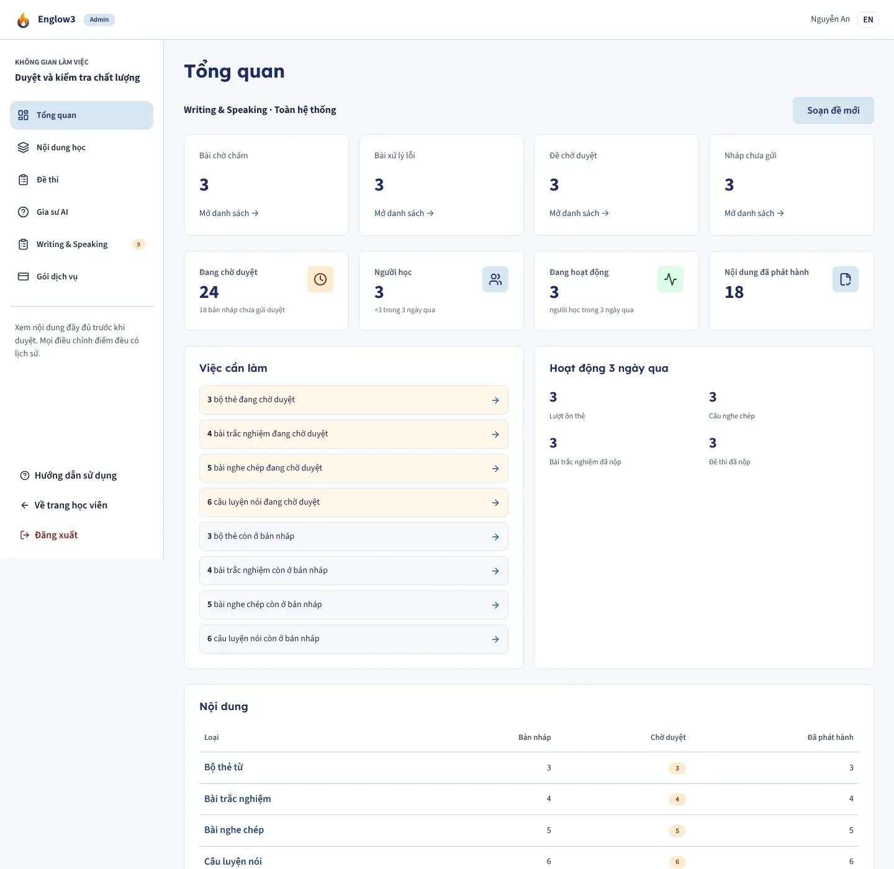
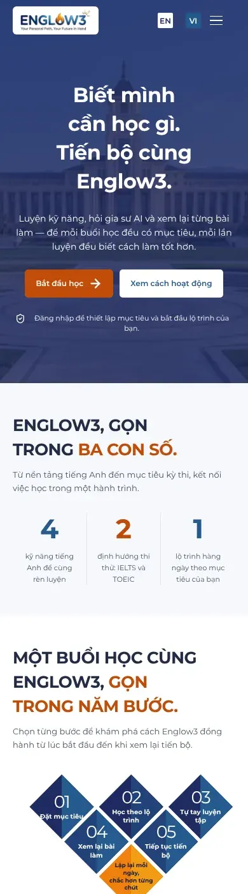

# 2. Frontend web (`apps/web`)

Next.js 16 (App Router), React 19, Mantine 9, Apollo Client 4, Supabase SSR, React Hook Form + Zod.

## Cấu trúc thư mục

```text
apps/web/src
├── app/                  Route của Next.js: page.tsx, layout.tsx, route handler /api/*
│   ├── (marketing)/      Trang công khai: /, /pricing, /terms, /privacy, /welcome
│   ├── study/            Màn học: daily-path, flashcards, dictation, pronunciation, quiz, speaking, writing, assessments
│   ├── exams/            Thư viện đề và phòng thi
│   ├── ai-tutor/         Gia sư AI
│   ├── profile/          Hồ sơ, bảo mật, dữ liệu tài khoản
│   ├── admin/            Khu quản trị (Staff, Admin)
│   ├── auth/             forgot, reset, error, callback
│   └── api/              Route handler chạy phía server (xem bên dưới)
├── features/<tên>/       Mỗi chức năng một thư mục
│   ├── components/views  Màn hoàn chỉnh, được page.tsx gọi
│   ├── components/blocks Khối lớn trong màn (thẻ, banner, form)
│   ├── components/parts  Mảnh nhỏ chỉ chức năng này dùng
│   ├── graphql/          File .graphql, sinh hook bằng codegen
│   ├── hooks/            Hook theo hành vi, ví dụ useSpeakingRecorder
│   └── index.ts          Barrel: thứ được phép import từ bên ngoài
├── shared/               Dùng chung, không thuộc chức năng nào: SiteHeader, LibraryCard, PageLoader, i18n
├── lib/                  Hạ tầng: Apollo, Supabase client, theme Mantine, mã GraphQL sinh tự động
├── server/               Chỉ chạy phía server: gọi BFF, CSRF, rate limit, trạng thái dịch vụ
└── proxy.ts              Middleware của Next 16: làm mới phiên, CSP nonce, chặn khách khỏi trang thành viên
```

Các chức năng hiện có trong `features/`: `account`, `admin`, `ai-tutor`, `assessment`, `auth`, `content`,
`dictation`, `exam`, `flashcard`, `home`, `legal`, `onboarding`, `pricing`, `pronunciation`, `quiz`, `tour`.

## Các provider bọc toàn app

`app/layout.tsx` dựng cây provider theo thứ tự dưới. Thứ tự có ý nghĩa: provider bên trong được dùng dữ liệu của
provider bên ngoài.



- `auth` chỉ trả lời "có đăng nhập không"; `account` trả lời "người này là ai". `account` không tự đọc cookie.
- `ApolloWrapper` có `key` theo `userId`: đăng xuất rồi đăng nhập tài khoản khác sẽ dựng lại cache, không thể
  thấy dữ liệu của người trước.
- Hồ sơ người dùng không chặn khung trang: layout render ngay với `profile: null`, hồ sơ tải sau. Nhờ vậy khi
  backend trên Render đang "ngủ" và khởi động chậm, trang vẫn hiện.

## Phiên đăng nhập và bảo mật



| Cơ chế          | Ở đâu                                | Mục đích                                                                                                 |
| --------------- | ------------------------------------ | -------------------------------------------------------------------------------------------------------- |
| Cookie HttpOnly | `lib/supabase`, `app/api/auth/*`     | Script trên trang không đọc được token                                                                   |
| `proxy.ts`      | Mọi request trang                    | Làm mới phiên, chặn khách vào `/study`, `/exams`, `/ai-tutor`, `/profile`, `/admin`                      |
| CSP có nonce    | `proxy.ts`, `config/securityHeaders` | Chỉ script có nonce của response đó được chạy                                                            |
| CSRF            | `server/csrf.ts`                     | Route handler đổi trạng thái (auth, GraphQL, xuất/xoá tài khoản) kiểm tra nguồn gốc request              |
| Rate limit      | `server/rateLimit.ts`                | Giới hạn theo người gọi ở `/api/graphql`, `/api/bff/rest`, xoá tài khoản; đếm trong bộ nhớ từng instance |
| Khu admin       | `app/admin/layout.tsx`               | Learner gõ `/admin` bị đưa về `/` trước khi render; backend vẫn kiểm tra lại                             |

Route handler trong `app/api`:

| Route                                                                            | Việc                                                                |
| -------------------------------------------------------------------------------- | ------------------------------------------------------------------- |
| `/api/auth/login`, `register`, `logout`, `oauth`, `forgot`, `password`, `resend` | Luồng tài khoản với Supabase                                        |
| `/api/graphql`                                                                   | Cửa duy nhất từ trình duyệt tới BFF, thêm token từ cookie           |
| `/api/bff/rest/[...path]`                                                        | Chuyển tiếp REST tới BFF: import nội dung, file lớn                 |
| `/api/tutor/stream`, `audio`, `data`                                             | Stream câu trả lời gia sư AI (SSE), upload ghi âm, xuất/xoá dữ liệu |
| `/api/account/export`, `erase`, `subscription`                                   | Xuất dữ liệu, xoá tài khoản, gói dịch vụ                            |
| `/api/system/status`                                                             | Trạng thái backend/AI để hiện thông báo "đang khởi động lại"        |

## Lấy dữ liệu

- **GraphQL có kiểu.** Mỗi chức năng viết truy vấn trong `features/*/graphql/*.graphql`. Lệnh `pnpm --filter web codegen`
  sinh ra `lib/graphql/generated/` gồm `schemaTypes.ts`, `documents.ts` (dùng được ở Server Component) và
  `hooks.ts` (hook React, chỉ import từ Client Component).
- **Apollo Client** gửi tới `/api/graphql` cùng origin. Truy vấn `network-only` luôn đi tới server; các truy vấn
  khác lấy cache sau lần tải đầu.
- **Thông báo backend chậm.** Apollo đếm thời gian mỗi operation; quá ngưỡng thì `SlowBackendNotice` giải thích
  thay vì để skeleton quay mãi.
- **Thao tác chạy lâu** (chấm phát âm, chấm Viết/Nói, gia sư AI) trả về bản ghi có trạng thái. Màn hình hỏi lại
  định kỳ (polling) cho tới khi trạng thái kết thúc; gia sư AI dùng thêm SSE để hiện chữ dần.
- **Bản nháp** bài Viết được lưu cả lên server lẫn `localStorage` (`shared/storage/browserDrafts.ts`), để mất
  mạng không mất bài.

## Design system

Chi tiết trong `apps/web/docs/design-system.md`. Tóm tắt:

| Vai trò            | Token      | Giá trị   | Dùng cho                                         |
| ------------------ | ---------- | --------- | ------------------------------------------------ |
| Màu chính          | `brand.7`  | `#255A8E` | Nút chính, link, viền focus                      |
| Tiêu đề, panel tối | `brand.9`  | `#1F2A60` | Navy của logo                                    |
| Nhấn               | `orange.7` | `#C24C0A` | Một hành động chính mỗi màn, chữ trắng           |
| Nhấn không chữ     | `orange.5` | `#EF800C` | Ngọn lửa của logo: thanh tiến độ, gạch chân menu |
| Nền trang          | `ink.0`    | `#F6F8FB` |                                                  |
| Chữ thân           | `ink.8`    | `#222C45` |                                                  |

- Chữ: Lexend cho tiêu đề, Source Sans 3 cho nội dung, đều có bộ ký tự tiếng Việt.
- Mỗi màn tối đa một nút cam. Thẻ trong thư viện (`LibraryCard`) không dùng cam.
- Nút cao tối thiểu 44px, mọi phần tử focus được đều có viền 2px, tôn trọng `prefers-reduced-motion`.
- Đa ngôn ngữ: `shared/constants/translations` chứa chuỗi tiếng Việt và tiếng Anh, chọn qua `LanguageSwitcher`.

## Các màn chính

| Đường dẫn                                         | Màn                                                           | Vai trò      |
| ------------------------------------------------- | ------------------------------------------------------------- | ------------ |
| `/`                                               | Trang giới thiệu (khách) hoặc trang chủ học viên              | Mọi người    |
| `/pricing`, `/terms`, `/privacy`                  | Bảng giá, điều khoản, bảo mật                                 | Mọi người    |
| `/study/daily-path`                               | Lộ trình hằng ngày, nhiệm vụ, XP, chuỗi ngày                  | Learner      |
| `/study/flashcards`, `/[setId]`, `/[setId]/study` | Thư viện bộ thẻ, chi tiết, ôn tập                             | Learner      |
| `/study/dictation`, `/[lessonId]`, `/review`      | Bài chính tả, làm bài, câu hay sai                            | Learner      |
| `/study/quiz/[quizId]`                            | Làm trắc nghiệm                                               | Learner      |
| `/study/pronunciation`, `/[lessonId]`             | Luyện phát âm                                                 | Learner      |
| `/study/speaking`, `/study/writing`, `/[id]`      | Luyện Nói, Viết có chấm theo tiêu chí                         | Learner      |
| `/study/assessments`, `/attempts/[id]`            | Lịch sử bài Viết/Nói và báo cáo                               | Learner      |
| `/exams`, `/exams/[id]`                           | Thư viện đề thi thử, phòng thi                                | Learner      |
| `/ai-tutor`                                       | Gia sư AI                                                     | Learner      |
| `/profile`                                        | Hồ sơ, mục tiêu, bảo mật, dữ liệu                             | Learner      |
| `/admin`, `/admin/*`                              | Tổng quan, đề thi, nội dung, chấm bài, gói dịch vụ, gia sư AI | Staff, Admin |

| Trang chủ học viên                                        | Lộ trình hằng ngày                             |
| --------------------------------------------------------- | ---------------------------------------------- |
|  |  |

| Hồ sơ                          | Khu quản trị                             |
| ------------------------------ | ---------------------------------------- |
|  |  |

Màn hình trên điện thoại dùng cùng code, bố cục co về một cột ở 390px:



## Kiểm thử

- `vitest` + Testing Library cho component và hook (khoảng 450 test).
- Test route handler chạy môi trường `node` (`// @vitest-environment node`).
- CI chạy `lint`, `tsc --noEmit`, `test`, `prettier --check` và kiểm tra mã GraphQL sinh tự động khớp schema.
