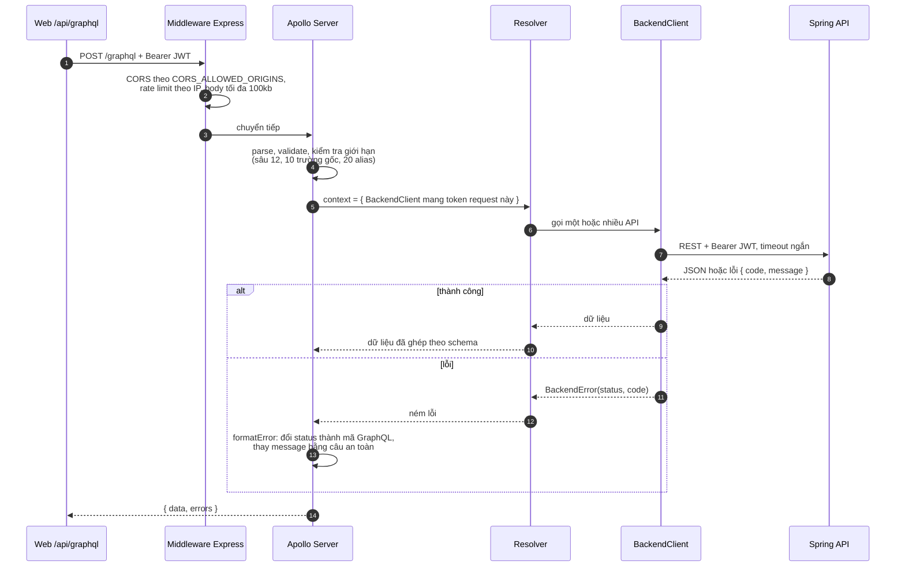
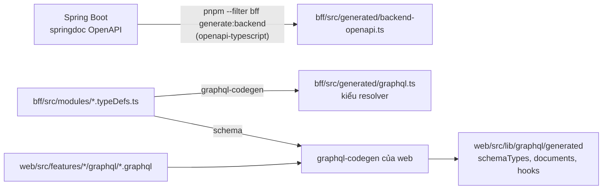

# 3. BFF GraphQL (`apps/bff`)

BFF (Backend for Frontend) là lớp GraphQL mỏng giữa web và backend Spring. Nó lo **hình dạng dữ liệu cho màn
hình**: một truy vấn GraphQL lấy đủ thứ một màn cần, thay vì web gọi năm endpoint REST. Nó **không** chứa quy tắc
nghiệp vụ, không có cơ sở dữ liệu và không quyết định quyền.

Apollo Server 5 chạy trên Express. Cùng một `createApp()` trong `src/app.ts` được dùng cho server chạy lâu (local)
và cho Vercel function (`api/index.ts`), nên route và giới hạn ở local và trên deploy luôn giống nhau.

## Cấu trúc

```text
apps/bff/src
├── app.ts                 Cấu hình Express + Apollo, dùng chung cho local và Vercel
├── server.ts, index.ts    Chạy local trên cổng 4000
├── config/                Biến môi trường, CORS, rate limit
├── graphql/
│   ├── schema.ts          Ghép typeDefs và resolver của mọi module
│   ├── context.ts         Tạo BackendClient mới cho từng request
│   ├── errors.ts          Đổi lỗi backend thành lỗi GraphQL an toàn
│   ├── limits.ts          Giới hạn độ sâu, số alias, số trường gốc
│   └── scalars.ts         Date, DateTime
├── modules/<tên>/         Mỗi module một bộ
│   ├── <tên>.typeDefs.ts  Schema GraphQL
│   ├── <tên>.resolvers.ts Resolver: gọi API, ghép kết quả
│   ├── <tên>.api.ts       Hàm gọi REST backend
│   └── <tên>.types.ts     Kiểu trung gian, mapper
├── http/                  Route REST không đi qua GraphQL (stream, upload, import)
├── shared/http/           BackendClient, BackendError, ghi log lỗi
└── generated/             graphql.ts (codegen), backend-openapi.ts (kiểu từ OpenAPI của Spring)
```

Module hiện có: `assessment`, `contentManagement`, `dictation`, `exam`, `flashcard`, `onboarding`, `progress`, `quiz`,
`speaking`, `tutor`, `user`. Chúng khớp gần một-một với module backend.

## Một request đi qua BFF



## Đổi lỗi backend thành lỗi GraphQL

Message từ Spring không bao giờ được chuyển nguyên cho trình duyệt, vì có thể lộ chi tiết nội bộ. BFF chỉ trả về
mã đã ánh xạ, một câu cố định và `backendCode` (mã nghiệp vụ ổn định như `EXAM_SCORE_MISMATCH`) để giao diện
hiện thông báo phù hợp.

| HTTP từ backend               | Mã GraphQL                                        |
| ----------------------------- | ------------------------------------------------- |
| 400, 422                      | `BAD_USER_INPUT`                                  |
| 401                           | `UNAUTHENTICATED`                                 |
| 403                           | `FORBIDDEN`                                       |
| 404                           | `NOT_FOUND`                                       |
| 409                           | `CONFLICT`                                        |
| 429                           | `TOO_MANY_REQUESTS`                               |
| 502, 503, 504, không tới được | `BACKEND_UNAVAILABLE`                             |
| Lỗi khác trong resolver       | `INTERNAL_SERVER_ERROR`, chi tiết chỉ ghi vào log |

## Route REST cạnh GraphQL

Một số việc không hợp với GraphQL, nên BFF mở route REST riêng trong `src/http/`. Web gọi chúng qua
`/api/bff/rest/[...path]` hoặc route tutor riêng để vẫn giữ nguyên tắc "token chỉ ở server".

| Route                                | Lý do không dùng GraphQL                                                      |
| ------------------------------------ | ----------------------------------------------------------------------------- |
| Import nội dung                      | File sinh tự động nặng vài MB; nâng giới hạn body cho mọi query là không đáng |
| Upload media khi soạn bài            | Multipart                                                                     |
| Stream gia sư AI                     | Server-Sent Events, giữ kết nối mở                                            |
| Ghi âm gia sư AI                     | File WAV                                                                      |
| Xuất/xoá dữ liệu tài khoản và gia sư | File tải về                                                                   |
| Trạng thái dịch vụ                   | Gọi health của backend/AI để hiện thông báo khởi động lại                     |

## Kiểu dữ liệu được sinh tự động



CI có bước `verify / codegen`: chạy lại `pnpm --filter bff codegen` và báo lỗi nếu `apps/bff/src/generated` khác với bản
đã commit. Sửa typeDefs mà quên chạy codegen thì CI đỏ. Kiểu OpenAPI của backend được sinh lại bằng tay khi API
Spring đổi (`pnpm --filter bff generate:backend`, cần backend đang chạy).
