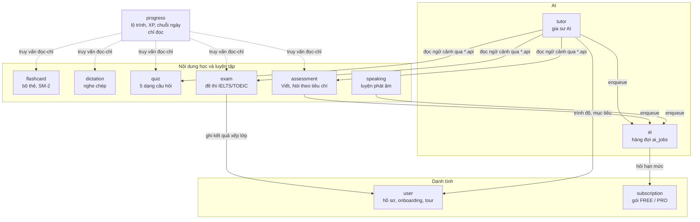
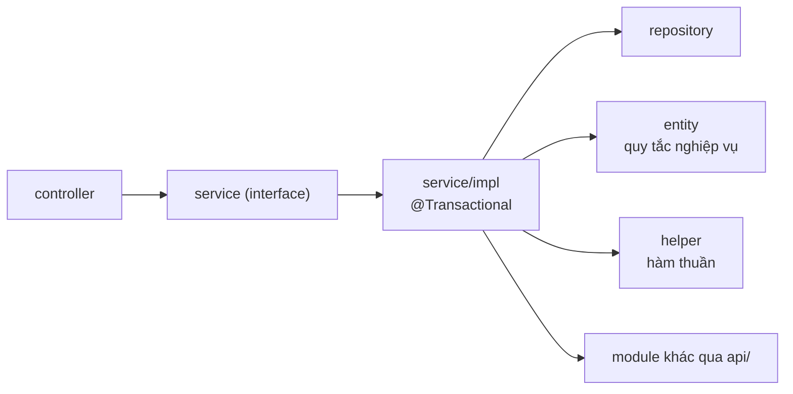
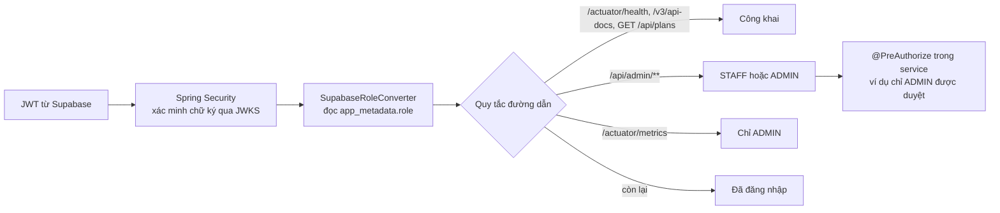
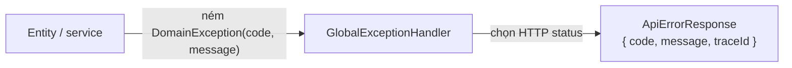

# 4. Backend (`Englow3_BE`)

Spring Boot 3.5, Java 21, Spring Data JPA, Flyway, PostgreSQL, springdoc OpenAPI, AWS SDK S3.

Backend là một **modular monolith**: một ứng dụng, một cơ sở dữ liệu, nhưng chia thành các module nghiệp vụ có ranh
giới rõ ràng. Nguồn gốc của mọi quy ước dưới đây là `CONTRIBUTING.md` và `docs/module-map.md` trong repo backend.

## Các module



| Module         | Làm gì                                                                          | Bảng chính                                                       |
| -------------- | ------------------------------------------------------------------------------- | ---------------------------------------------------------------- |
| `user`         | Hồ sơ, mục đích học, kỹ năng mục tiêu, onboarding, tour hướng dẫn               | `users`, `learner_profiles`, `learning_purposes`                 |
| `subscription` | Gói FREE/PRO, hạn dùng, hạn mức gọi AI mỗi ngày                                 | `user_subscriptions`                                             |
| `flashcard`    | Bộ thẻ, lịch ôn SM-2, lịch sử ôn, thống kê, import                              | `flashcard_sets`, `flashcards`, `flashcard_reviews`              |
| `dictation`    | Bài nghe chép, chấm từng câu, hàng đợi câu hay sai, import                      | `dictation_lessons`, `dictation_sentences`, `dictation_attempts` |
| `quiz`         | Trắc nghiệm 5 dạng, lượt làm, chấm                                              | `quizzes`, `quiz_questions`, `quiz_attempts`                     |
| `speaking`     | Câu mẫu luyện phát âm, bản ghi, kết quả chấm                                    | `speaking_prompts`, `speaking_attempts`                          |
| `assessment`   | Đề Viết/Nói tự do, bản nháp, chấm AI theo 4 tiêu chí, chấm tay                  | `assessment_tasks`, `assessment_attempts`, `assessment_reviews`  |
| `exam`         | Đề thi, phần, câu hỏi, thang điểm, lượt thi, bản nháp, chấm                     | `exams`, `exam_sections`, `questions`, `exam_attempts`           |
| `tutor`        | Hội thoại gia sư AI, phiên bản câu trả lời, tài liệu tham khảo, báo cáo, ghi âm | `tutor_conversations`, `tutor_messages`, `tutor_resources`       |
| `ai`           | Hàng đợi job gọi AI, hạn mức theo ngày, thử lại                                 | `ai_jobs`                                                        |
| `progress`     | Lộ trình hằng ngày, XP, cấp độ, chuỗi ngày, tổng quan admin. Không có bảng ghi  | (không có)                                                       |

Ngoài ra có hai gói kỹ thuật không phải module nghiệp vụ: `shared` (lỗi, bảo mật, storage, phân trang, log) và
`config` (Spring Security, OpenAPI, S3 client).

## Phân lớp bên trong một module

```text
<module>/
├── controller/     Chỉ xử lý HTTP: validate, tạo command, gọi một use case, trả ResponseEntity
├── api/            Interface cho module khác gọi (chỉ khi cần)
├── service/        Interface use case; service/impl/*Impl giữ transaction
├── repository/     Spring Data repository, projection
├── entity/         JPA entity, enum, và quy tắc nghiệp vụ bảo vệ trạng thái
├── helper/         Hàm thuần không trạng thái: chấm điểm, lập lịch, parse, import
├── dto/request, response   Bản ghi HTTP
├── dto/command, result     Bản ghi giữa controller và service
├── query/          Truy vấn đọc phức tạp (chỉ khi cần)
└── worker/         Việc chạy nền (chỉ khi cần)
```



Quy tắc chính:

- **Entity giữ bất biến.** Ví dụ `Exam.submitForReview()` từ chối nếu đề không ở `DRAFT` hoặc `REJECTED`. Entity
  được bảo vệ không có setter cho trường quan trọng.
- **Helper là hàm thuần** để test hết các trường hợp mà không cần cơ sở dữ liệu: `FlashcardSrs` (lịch ôn SM-2),
  `DictationScorer`, `QuizGrader`.
- **Một bảng chỉ một module ghi.** Module khác tham chiếu bằng UUID, không dùng `@ManyToOne` vượt module.
- **Không gọi dịch vụ chậm trong transaction.** Gọi AI, object storage đều nằm ngoài transaction; việc chậm thì lưu ý
  định trước, commit, rồi xếp hàng.

## Phân quyền



| Vai trò   | Được làm                                                                          |
| --------- | --------------------------------------------------------------------------------- |
| `LEARNER` | Học, làm bài, xem kết quả của chính mình, dùng gia sư AI                          |
| `STAFF`   | Soạn nội dung, gửi duyệt, chấm bài Viết/Nói của đề mình soạn                      |
| `ADMIN`   | Mọi việc của Staff, cộng duyệt, xuất bản, lưu trữ, sửa điểm, cấp gói, xem số liệu |

Role đọc từ `app_metadata` của JWT, không từ `user_metadata`, vì người dùng tự sửa được `user_metadata`. Trigger
trong cơ sở dữ liệu (`V026__sync_role_to_auth_app_metadata.sql`) đồng bộ role từ bảng `users` sang Supabase. Token phát
trước khi đổi role sẽ chưa có role mới cho tới khi được làm mới.

## Xử lý lỗi



| Exception                  | HTTP |
| -------------------------- | ---- |
| `BadRequestException`      | 400  |
| `ForbiddenException`       | 403  |
| `NotFoundException`        | 404  |
| `ConflictException`        | 409  |
| `TooManyRequestsException` | 429  |

`DomainException` chỉ mang mã ổn định (ví dụ `EXAM_NOT_DRAFT`) và câu mô tả. Việc quyết định một quy tắc bị vi phạm
là 409 hay 422 thuộc về `GlobalExceptionHandler`, không nằm trong entity hay service.

## API REST

Danh sách đầy đủ có tại `/swagger-ui` khi chạy backend. Nhóm theo module:

| Tiền tố                                                                                        | Module         | Người dùng                  |
| ---------------------------------------------------------------------------------------------- | -------------- | --------------------------- |
| `/api/user/me`, `/api/user/me/bootstrap`, `/api/user/me/tour`, `/api/user/me/export`, `/erase` | `user`         | Mọi vai trò                 |
| `/api/onboarding/*`                                                                            | `user`         | Learner                     |
| `/api/plans`, `/api/user/me/subscription`, `/api/admin/subscriptions`                          | `subscription` | Công khai / Learner / Admin |
| `/api/daily-path`, `/api/admin/overview`                                                       | `progress`     | Learner / Admin             |
| `/api/flashcards/*`, `/api/admin/flashcards/*`                                                 | `flashcard`    | Learner / Staff, Admin      |
| `/api/dictation/*`, `/api/admin/dictation/*`                                                   | `dictation`    | Learner / Staff, Admin      |
| `/api/quizzes/*`, `/api/quiz-attempts/*`, `/api/admin/quizzes/*`                               | `quiz`         | Learner / Staff, Admin      |
| `/api/speaking/*`, `/api/admin/speaking/*`                                                     | `speaking`     | Learner / Staff, Admin      |
| `/api/assessments/*`, `/api/admin/assessments/*`                                               | `assessment`   | Learner / Staff, Admin      |
| `/api/exams/*`, `/api/exam-attempts/*`, `/api/admin/exams/*`, `/api/admin/question-bank`       | `exam`         | Learner / Staff, Admin      |
| `/api/tutor/*`, `/api/admin/tutor/*`                                                           | `tutor`        | Learner / Staff, Admin      |

## Cơ sở dữ liệu và migration

- Flyway, các file `V001` đến `V072` trong `src/main/resources/db/migration`, cộng `R__seed_learning_purposes.sql`.
- **Không bao giờ sửa migration đã chạy.** Flyway lưu checksum; sửa file cũ làm mọi môi trường đã chạy nó không khởi
  động được. Thay đổi schema luôn là migration mới.
- `open-in-view` tắt: service phải tải đủ dữ liệu trong transaction.

Sơ đồ quan hệ các bảng xem [5. Dữ liệu](05-du-lieu.md).

## Kiểm thử

Hai lớp, mỗi lớp một trách nhiệm (theo `CLAUDE.md` của backend):

- **Test entity:** quy tắc nghiệp vụ. Dựng entity trực tiếp, không Spring, không mock, không DB. Mỗi quy tắc một test.
- **Test service:** điều phối. Mock entity và repository; kiểm tra gọi đúng phương thức, rẽ nhánh đúng, ném đúng lỗi.
  Không lặp lại kiểm tra quy tắc đã có ở test entity.

Không có test controller.
