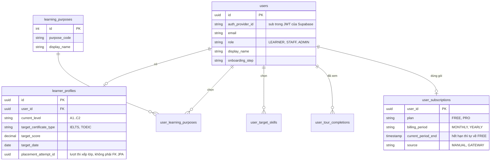
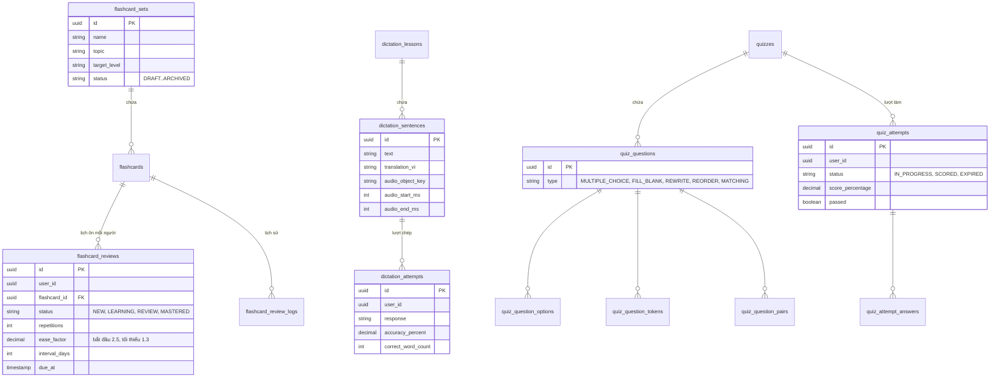
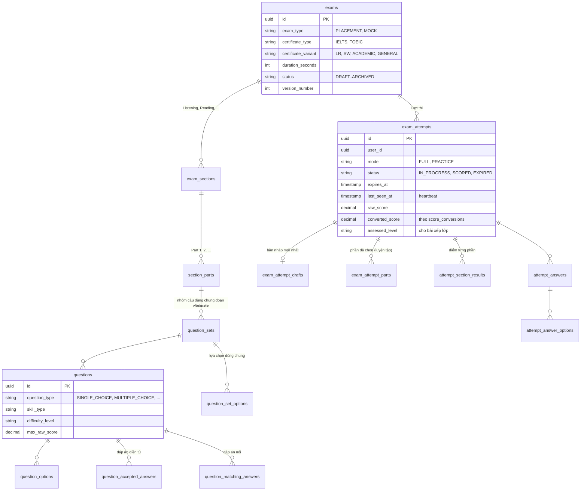
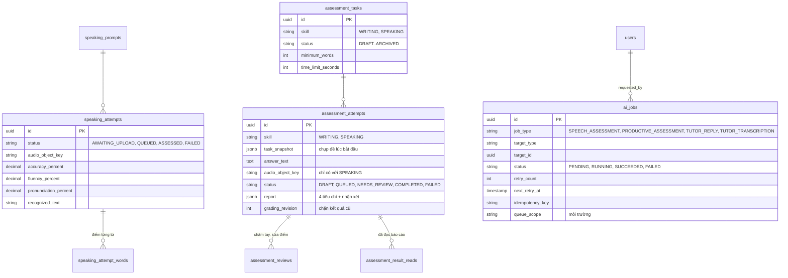
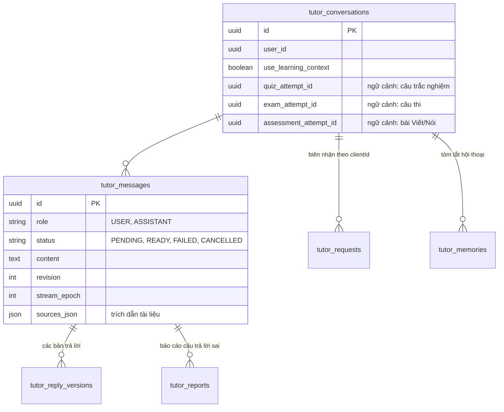

# 5. Dữ liệu

PostgreSQL 17 (image `pgvector/pgvector`), schema quản lý bằng Flyway (`V001` đến `V072`). Khoá chính là UUID, trừ vài bảng danh mục như `learning_purposes` dùng số tự tăng. Mỗi bảng có đúng
một module được ghi; sơ đồ dưới nhóm bảng theo module sở hữu.

Sơ đồ chỉ ghi các cột quan trọng để hiểu luồng, không phải toàn bộ cột.

## Người dùng và gói dịch vụ (`user`, `subscription`)

Khi một tài khoản được tạo trên Supabase, trigger `V024` tự tạo dòng `users` tương ứng. Khi Admin đổi
`users.role`, trigger `V026` chép role sang `app_metadata` của Supabase để role nằm trong JWT.

## Học và luyện tập (`flashcard`, `dictation`, `quiz`)

`quiz_question_tokens` giữ các mảnh chữ theo vai trò (`ACCEPTED_ANSWER`, `WORD_BANK`, `SCRAMBLED`, `CORRECT_ORDER`, ...)
nên năm dạng câu hỏi dùng chung một cấu trúc.

## Đề thi (`exam`)

`score_conversions` đổi điểm thô sang thang điểm của chứng chỉ (band IELTS, điểm TOEIC). `grading_criteria` và
`attempt_answer_criterion_scores` đã có bảng nhưng luồng hiện tại chưa dùng.

## Luyện nói, viết và AI (`speaking`, `assessment`, `ai`)

## Gia sư AI (`tutor`)

Bảng khác của module: `tutor_resources` (tài liệu tham khảo đã duyệt), `tutor_recordings` (ghi âm WAV, xoá sau 24 giờ),
`tutor_policy` (cấu hình bật/tắt), `tutor_audit`, `tutor_deleted_requests`.

## Object storage

| Bucket     | Quyền     | Chứa                                  | Module sở hữu khoá                |
| ---------- | --------- | ------------------------------------- | --------------------------------- |
| `exams`    | Riêng tư  | Audio, ảnh của đề thi                 | `exam`                            |
| `learning` | Riêng tư  | Audio flashcard, audio bài chính tả   | `flashcard`, `dictation`          |
| `speaking` | Riêng tư  | Bản ghi luyện phát âm, Nói, gia sư AI | `speaking`, `assessment`, `tutor` |
| `avatars`  | Công khai | Ảnh đại diện, ảnh bìa                 | `user`                            |

Cơ sở dữ liệu chỉ lưu khoá tương đối (`audio_object_key`). Backend cấp URL có chữ ký, thời hạn ngắn, để trình duyệt
tải hoặc upload trực tiếp; file không đi qua backend.
