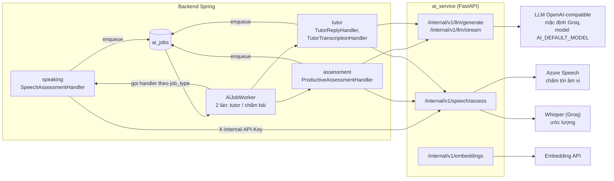
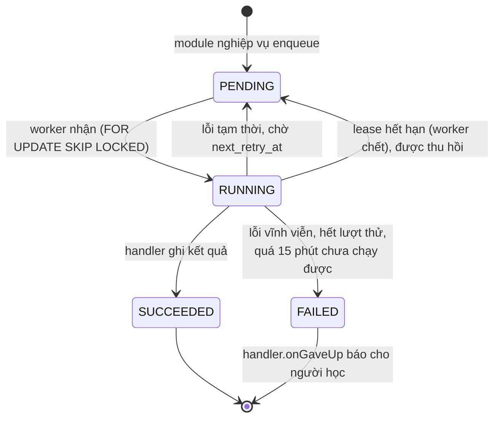

# 6. AI

Ba chức năng dùng AI: **chấm phát âm**, **chấm bài Viết/Nói** và **gia sư AI**. Cả ba đi qua cùng một con đường:

1. Module nghiệp vụ lưu ý định (bản ghi ở trạng thái chờ) rồi **xếp một job vào bảng `ai_jobs`** trong cùng transaction.
2. `AiJobWorker` trong backend nhận job, gọi **AI service** (FastAPI) qua mạng nội bộ.
3. AI service gọi **nhà cung cấp** (LLM, nhận dạng giọng nói, embedding) và trả kết quả đã chuẩn hoá.
4. Handler của module nghiệp vụ ghi kết quả vào bảng của chính module đó.
5. Giao diện hỏi lại định kỳ (hoặc nghe SSE với gia sư) cho tới khi có kết quả.

Không module nào gọi nhà cung cấp trực tiếp, và web/BFF không bao giờ gọi AI service.

## Hàng đợi `ai_jobs`

| Loại job                | Module       | Làm gì                                                         |
| ----------------------- | ------------ | -------------------------------------------------------------- |
| `SPEECH_ASSESSMENT`     | `speaking`   | Chấm phát âm một bản ghi đọc câu mẫu                           |
| `PRODUCTIVE_ASSESSMENT` | `assessment` | Chấm bài Viết (LLM) hoặc Nói (giọng nói + LLM) theo 4 tiêu chí |
| `TUTOR_REPLY`           | `tutor`      | Sinh câu trả lời của gia sư                                    |
| `TUTOR_TRANSCRIPTION`   | `tutor`      | Chép lời bản ghi âm câu hỏi gửi gia sư                         |

Cách worker chạy:

- **Hai làn riêng.** Làn gia sư (`TUTOR_*`) và làn chấm bài (`*_ASSESSMENT`) chạy song song, mỗi làn một job một lúc.
  Một bài chấm chậm không làm gia sư đứng hình.
- **Đánh thức ngay sau commit.** Khi một job được xếp vào, sự kiện `AiJobQueued` đánh thức worker sau khi transaction
  commit. Lịch quét mỗi 2 giây vẫn chạy để bắt job bị lỡ hoặc job từ instance khác.
- **Không giữ transaction khi gọi mạng.** Nhận job, gọi AI service, ghi kết quả là ba bước tách rời.
- **Lease và heartbeat.** Job đang chạy được gia hạn khoá mỗi 10 giây. Worker chết thì khoá hết hạn (mặc định 3 phút)
  và job được nhận lại. Một lần chạy quá 140 giây bị coi là lỗi tạm thời.
- **AI service chưa sẵn sàng** (đang khởi động) thì job được hoãn 10 giây, không tính là lỗi.
- **Báo lỗi cho người học ở một chỗ.** Khi job kết thúc mà không có kết quả (bị từ chối, hết lượt thử, bị thu hồi quá
  nhiều lần, handler ném lỗi), worker gọi `onGaveUp` của handler. Đó là nơi duy nhất bản ghi nghiệp vụ được chuyển
  sang `FAILED`.

## Hạn mức gọi AI

Mỗi job ghi `requested_by_user_id`. Trước khi xếp job, module hỏi `AiJobQueue` người này còn lượt trong ngày không;
`AiJobQueue` hỏi `subscription.api.PlanEntitlements` gói hiện tại cho bao nhiêu lượt. Phát âm và gia sư dùng chung một
hạn mức, đếm ở một chỗ, nên người học không thể dùng hết hạn mức hai lần.

## AI service (`ai_service/`)

FastAPI, Python 3.13. Không trạng thái, không cơ sở dữ liệu, không có API công khai. Nó giữ khoá của nhà cung cấp và
chuẩn hoá phản hồi của họ.

| Endpoint                                        | Việc                                                              |
| ----------------------------------------------- | ----------------------------------------------------------------- |
| `POST /internal/v1/llm/generate`                | Sinh văn bản qua API tương thích OpenAI                           |
| `POST /internal/v1/llm/stream`                  | Như trên nhưng stream từng đoạn (gia sư AI)                       |
| `POST /internal/v1/embeddings`                  | Vector có số chiều cố định. Đã có endpoint, backend hiện chưa gọi |
| `POST /internal/v1/speech/assess`               | Chấm phát âm một file audio                                       |
| `GET /health/live`, `/health/ready`, `/version` | Kiểm tra sống, cấu hình đủ, phiên bản                             |

Mọi đường `/internal/*` bắt buộc header `X-Internal-API-Key`. Không mở cổng này ra Internet.

Model LLM do backend chọn (`AI_DEFAULT_MODEL`, mặc định `openai/gpt-oss-20b` trên Groq) và gửi kèm mỗi request. Gia sư
AI tìm tài liệu tham khảo bằng full-text search của PostgreSQL (`to_tsvector` / `websearch_to_tsquery` trên
`tutor_resources`), không dùng vector.

### Hai nhà cung cấp chấm phát âm

Chọn bằng `AI_SERVICE_SPEECH_PROVIDER`:

| Nhà cung cấp       | Cách chấm                                                                                                                                                                                                                 |
| ------------------ | ------------------------------------------------------------------------------------------------------------------------------------------------------------------------------------------------------------------------- |
| `azure` (mặc định) | Azure Pronunciation Assessment: nhận dạng và chấm accuracy, fluency, completeness, prosody tới từng từ và âm vị. Có câu mẫu thì so lỗi đọc thiếu/thừa                                                                     |
| `whisper`          | Chép lời qua Whisper (Groq) kèm mốc thời gian từng từ. Không chấm phát âm thật: fluency ước lượng từ tốc độ nói và khoảng ngắt, pronunciation ước lượng từ độ tự tin của bộ nhận dạng. Kết quả được đánh dấu là ước lượng |

## Chấm bài Viết/Nói

Không để mô hình tự quyết điểm cuối cùng:

1. LLM trả về điểm và bằng chứng cho đủ **4 tiêu chí**. Thiếu tiêu chí nào là kết quả không hợp lệ.
2. Với bài Nói, điểm từ dịch vụ giọng nói (phát âm, lưu loát) đi kèm làm bằng chứng; nhận xét ngôn ngữ của LLM không
   thay thế được điểm này.
3. **Backend tự tính điểm trung bình** và gắn nhãn "điểm luyện tập ước lượng".
4. Nếu tắt chấm tự động, bài nộp vào thẳng hàng chờ chấm tay của Staff.

## Data pipeline (offline)

`data_pipeline/` trong repo backend là bộ công cụ chạy ngoài ứng dụng để sinh và kiểm tra nội dung (flashcard, bài
nghe chép). Nó không ghi thẳng vào cơ sở dữ liệu: kết quả được import qua API admin (`POST /api/admin/flashcards/import`,
`POST /api/admin/dictation/import`), luôn có bước chạy thử (dry run) và luôn vào trạng thái nháp để qua quy trình duyệt.
