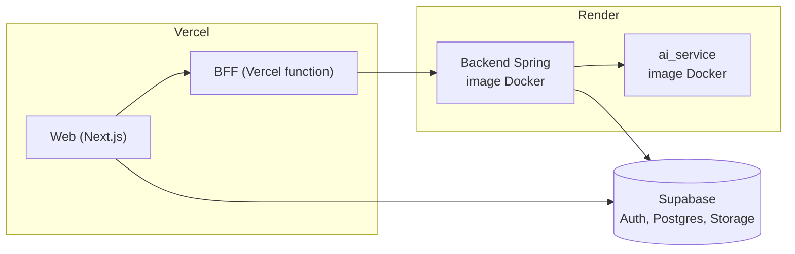
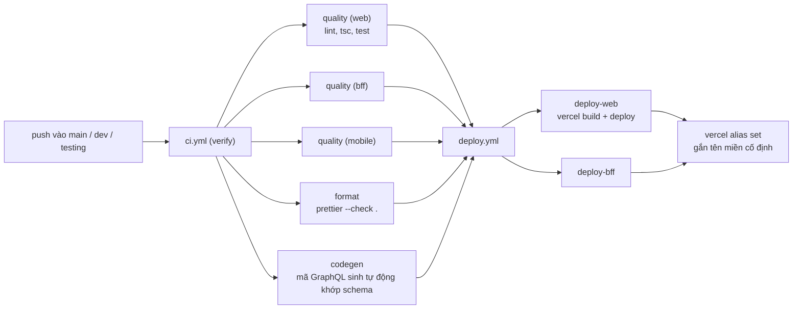
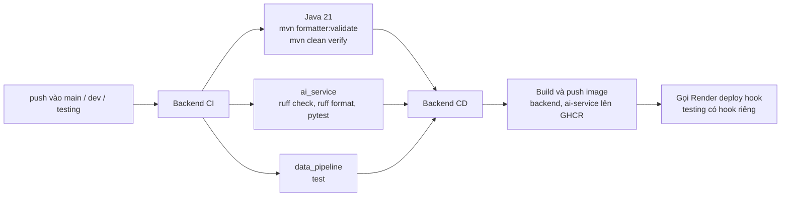
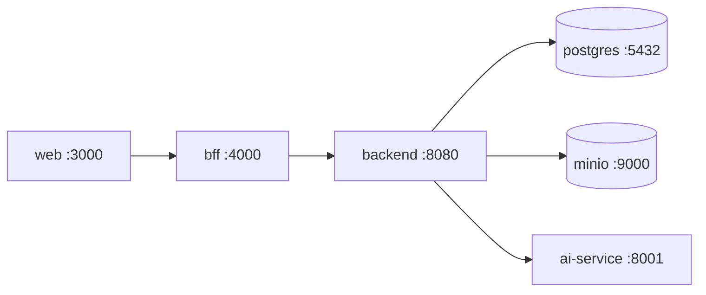

# 7. Triển khai

## Ba môi trường

Mỗi môi trường ứng với một branch, có tên miền cố định và chạy độc lập với nhau.

| Branch    | Môi trường | Web                            | BFF                            | Backend                                                                       |
| --------- | ---------- | ------------------------------ | ------------------------------ | ----------------------------------------------------------------------------- |
| `main`    | Production | Tên miền production của Vercel | Tên miền production của Vercel | Render, dùng chung `BACKEND_URL` của dự án                                    |
| `dev`     | Preview    | `englow3-web-dev.vercel.app`   | `englow3-bff-dev.vercel.app`   | Render, dùng chung `BACKEND_URL` của dự án                                    |
| `testing` | Preview    | `englow3-web-test.vercel.app`  | `englow3-bff-test.vercel.app`  | `englow3-backend-testing.onrender.com`, build từ branch `testing` của backend |

`testing` không có branch protection: push thẳng vào để có một tên miền ổn định mà không đụng tới `dev`, nơi cả nhóm
đang làm việc.



## Pipeline frontend (`Englow3_FE`)



- Deploy **chỉ chạy khi `ci.yml` đã pass trên cùng commit.** Một bước đỏ (kể cả chỉ sai format) là không deploy.
- Thay đổi chỉ gồm `**/*.md`, `.claude/**`, `.idea/**`, `.gitignore` không kích hoạt deploy, nhưng CI vẫn chạy
  `prettier --check` trên chúng.
- Chạy tay (`workflow_dispatch`) bỏ qua bước kiểm tra, dành cho trường hợp cần đẩy bản sửa gấp.
- Pull request chỉ chạy `ci.yml`, không tạo preview.

Trước khi push, chạy những lệnh CI sẽ chạy:

```bash
pnpm format:check
```

```bash
pnpm lint && pnpm typecheck && pnpm test
```

## Pipeline backend (`Englow3_BE`)



## Biến môi trường quan trọng

Giá trị thật đặt trên Vercel/Render, không commit. Danh sách đầy đủ: `apps/web/.env.local.example`, `apps/bff/.env.example`,
`.env.example` và `src/main/resources/application.yml` của backend.

| Nơi        | Biến                                                                                                        | Ý nghĩa                                                   |
| ---------- | ----------------------------------------------------------------------------------------------------------- | --------------------------------------------------------- |
| Web        | `NEXT_PUBLIC_SUPABASE_URL`, `NEXT_PUBLIC_SUPABASE_PUBLISHABLE_KEY`                                          | Dự án Supabase                                            |
| Web        | `BFF_GRAPHQL_URL`                                                                                           | BFF mà server của web gọi tới (chỉ phía server)           |
| Web        | `NEXT_PUBLIC_SITE_URL`, `NEXT_PUBLIC_OPERATOR_NAME`, `NEXT_PUBLIC_CONTACT_EMAIL`                            | Sitemap, trang điều khoản, bảng giá                       |
| BFF        | `BACKEND_URL`                                                                                               | Địa chỉ Spring API                                        |
| BFF        | `CORS_ALLOWED_ORIGINS`                                                                                      | Origin của web; để trống là cho mọi origin                |
| Backend    | `DB_URL`, `DB_USERNAME`, `DB_PASSWORD`                                                                      | Postgres                                                  |
| Backend    | `SUPABASE_ISSUER_URI`, `SUPABASE_JWKS_URI`                                                                  | Xác minh JWT                                              |
| Backend    | `S3_ENDPOINT`, `S3_REGION`, `S3_ACCESS_KEY`, `S3_SECRET_KEY`, `STORAGE_*_BUCKET`                            | Object storage                                            |
| Backend    | `AI_ENABLED`, `AI_WORKER_ENABLED`, `AI_SERVICE_BASE_URL`, `AI_SERVICE_INTERNAL_API_KEY`, `AI_DEFAULT_MODEL` | Bật hàng đợi AI, nơi gọi AI service, model                |
| Backend    | `AI_DAILY_REQUEST_LIMIT` (mặc định 100), `PLAN_PRO_AI_DAILY_LIMIT` (300)                                    | Hạn mức gọi AI mỗi ngày của gói FREE, PRO                 |
| Backend    | `ASSESSMENT_AUTOMATIC_WRITING`, `ASSESSMENT_AUTOMATIC_SPEAKING` (mặc định tắt)                              | Bật chấm tự động Viết/Nói; tắt thì vào hàng chờ chấm tay  |
| Backend    | `TUTOR_STREAMING_ENABLED`, `TUTOR_VOICE_ENABLED`, `TUTOR_MEMORY_ENABLED`                                    | Bật stream, ghi âm, tóm tắt hội thoại của gia sư          |
| Backend    | `APP_TIME_ZONE` (mặc định `Asia/Ho_Chi_Minh`)                                                               | Múi giờ tính "một ngày": chuỗi ngày, nhiệm vụ, hạn mức AI |
| AI service | `AI_SERVICE_LLM_*`, `AI_SERVICE_SPEECH_PROVIDER`, `AI_SERVICE_AZURE_SPEECH_*`, `AI_SERVICE_WHISPER_*`       | Khoá và địa chỉ nhà cung cấp                              |

## Chạy local



Backend có `docker-compose.yml` dựng `postgres`, `minio` (tạo sẵn bucket) và `ai-service`. Chạy Spring Boot bằng Maven,
rồi chạy BFF và web từ repo frontend:

```bash
pnpm dev:bff
```

```bash
pnpm dev:web
```

## Khi backend "ngủ"

Gói Render miễn phí tắt service sau một thời gian không có request; request đầu tiên phải chờ khởi động lại. Web xử lý
việc này để người dùng không thấy trang trắng:

- Layout render ngay mà không chờ hồ sơ người dùng.
- `/api/system/status` hỏi trạng thái backend và AI service; `ServiceRecovery` hiện thông báo "đang khởi động lại".
- `SlowBackendNotice` giải thích khi một truy vấn chạy quá lâu.

Chi tiết vận hành khi có sự cố: `docs/production-ops-runbook.md` trong repo backend và
`apps/web/docs/testing-service-recovery.md` trong repo frontend.
