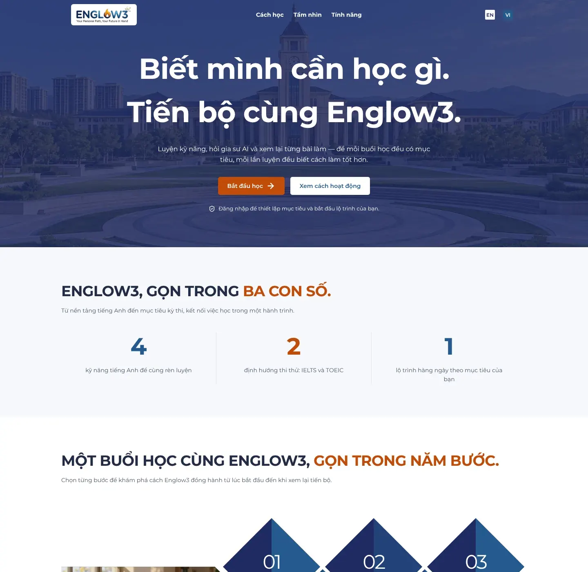

# Thiết kế hệ thống Englow3

Englow3 là nền tảng học tiếng Anh cho người Việt: lộ trình học hằng ngày, flashcard lặp lại ngắt quãng, chính tả
(nghe chép), trắc nghiệm, luyện phát âm, luyện Viết/Nói có chấm điểm, thi thử IELTS/TOEIC và gia sư AI.

Bộ tài liệu này mô tả hệ thống như nó đang chạy trên branch `testing` của hai repo:

| Repo                                                        | Nội dung                                                             |
| ----------------------------------------------------------- | -------------------------------------------------------------------- |
| [`IamHDA/Englow3_FE`](https://github.com/IamHDA/Englow3_FE) | Web (Next.js), BFF (Apollo GraphQL), app mobile (Expo, mới khởi tạo) |
| [`IamHDA/Englow3_BE`](https://github.com/IamHDA/Englow3_BE) | Backend (Spring Boot), AI service (FastAPI), data pipeline           |

## Đọc theo thứ tự nào

| Tài liệu                                          | Trả lời câu hỏi                                                        |
| ------------------------------------------------- | ---------------------------------------------------------------------- |
| [1. Kiến trúc tổng thể](01-kien-truc-tong-the.md) | Hệ thống gồm những phần nào, một request đi qua đâu                    |
| [2. Frontend web](02-frontend-web.md)             | Cấu trúc Next.js, phiên đăng nhập, gọi dữ liệu, design system, các màn |
| [3. BFF GraphQL](03-bff.md)                       | Lớp trung gian giữa web và backend làm gì, không làm gì                |
| [4. Backend](04-backend.md)                       | Các module Spring Boot, phân quyền, xử lý lỗi, các worker nền          |
| [5. Dữ liệu](05-du-lieu.md)                       | Bảng nào thuộc module nào, quan hệ giữa chúng                          |
| [6. AI](06-ai.md)                                 | Hàng đợi `ai_jobs`, AI service, nhà cung cấp LLM/giọng nói             |
| [7. Triển khai](07-trien-khai.md)                 | CI/CD, môi trường dev/testing/production, biến môi trường quan trọng   |

Luồng hoạt động của từng chức năng, mỗi chức năng một file, có sequence diagram và ảnh màn hình:

| Chức năng                                                   | Module backend         |
| ----------------------------------------------------------- | ---------------------- |
| [Đăng nhập và onboarding](luong/01-dang-nhap-onboarding.md) | `user`                 |
| [Lộ trình hằng ngày](luong/02-lo-trinh-hang-ngay.md)        | `progress`             |
| [Flashcard](luong/03-flashcard.md)                          | `flashcard`            |
| [Chính tả (nghe chép)](luong/04-chinh-ta.md)                | `dictation`            |
| [Trắc nghiệm](luong/05-trac-nghiem.md)                      | `quiz`                 |
| [Luyện phát âm](luong/06-phat-am.md)                        | `speaking`, `ai`       |
| [Luyện Viết và Nói](luong/07-viet-noi.md)                   | `assessment`, `ai`     |
| [Thi thử](luong/08-thi-thu.md)                              | `exam`                 |
| [Gia sư AI](luong/09-gia-su-ai.md)                          | `tutor`, `ai`          |
| [Soạn và duyệt nội dung](luong/10-soan-duyet-noi-dung.md)   | mọi module có nội dung |
| [Gói dịch vụ](luong/11-goi-dich-vu.md)                      | `subscription`         |

## Tài liệu gốc trong từng repo

Bộ tài liệu này tổng hợp lại từ code và các tài liệu sẵn có. Khi cần chi tiết hơn, đọc thẳng nguồn:

- Backend: `docs/module-map.md` (ranh giới module, ai ghi bảng nào), `docs/decisions.md`, `CONTRIBUTING.md`,
  `docs/production-ops-runbook.md`, `docs/deploy-storage-and-grading.md`.
- Frontend: `apps/web/docs/design-system.md` (màu, chữ, quy tắc nút cam), `apps/web/README.md`,
  `apps/web/docs/landing-visual-direction.md`.

Khi code và tài liệu này lệch nhau, code đúng. Ảnh màn hình chụp từ code thật với dữ liệu mẫu: nội dung chữ
trong ảnh là giả, bố cục và màu là thật.
