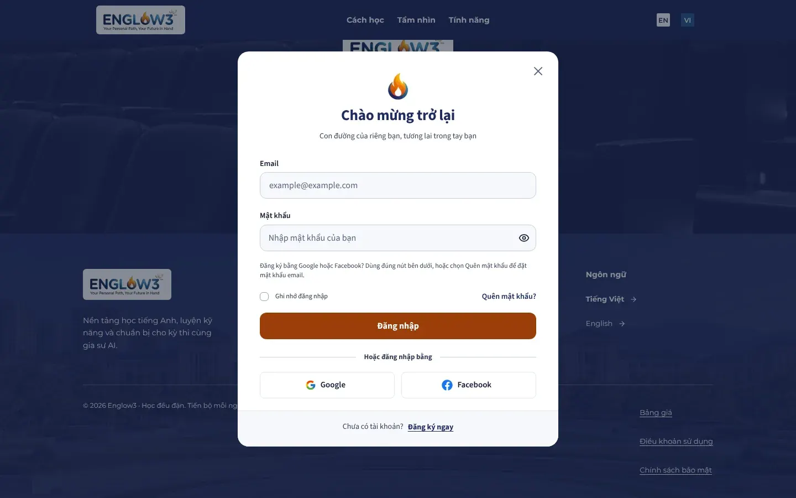
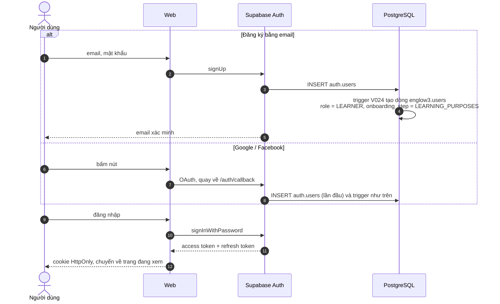
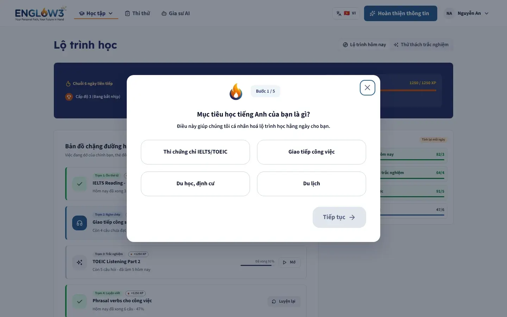
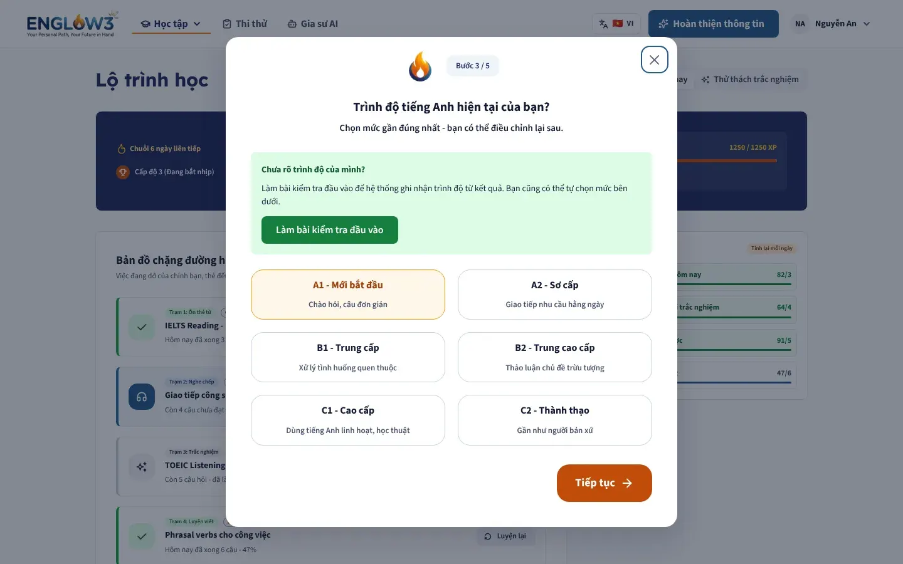
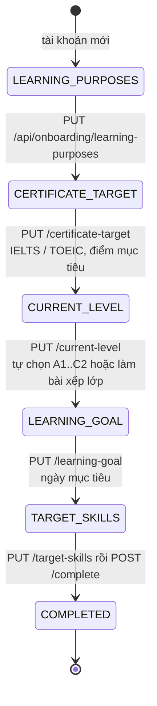
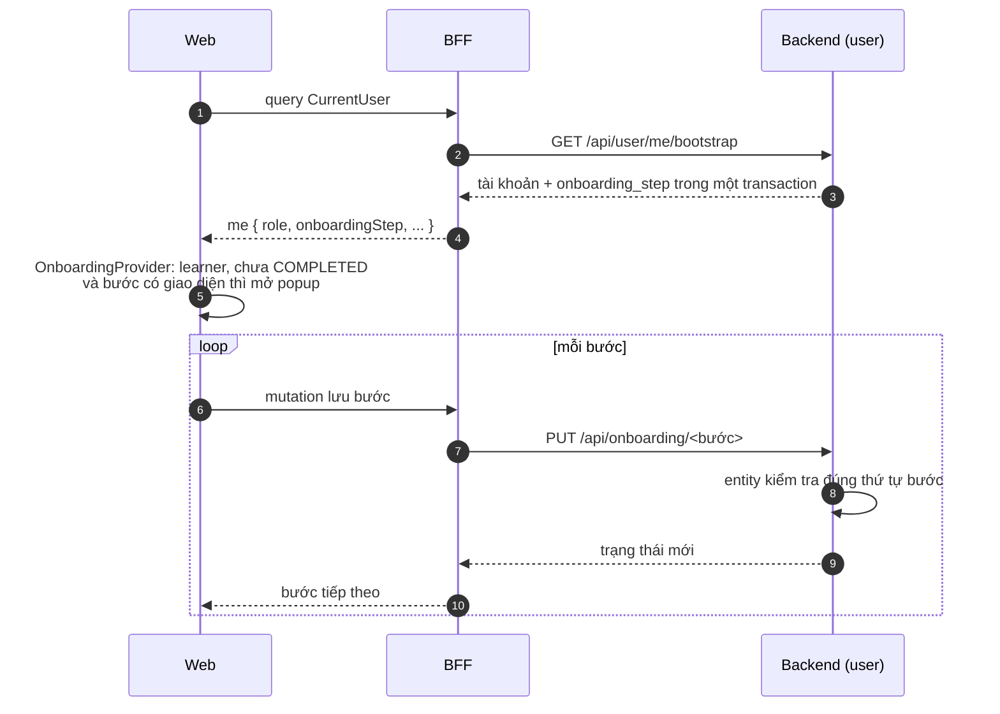

# Đăng nhập và onboarding

Module backend: `user`. Feature web: `auth`, `account`, `onboarding`.

## Đăng ký và đăng nhập

Supabase giữ tài khoản và mật khẩu. Englow3 chỉ giữ hồ sơ, liên kết với Supabase qua `users.auth_provider_id`.

- Quên mật khẩu: `/auth/forgot` gửi link qua Supabase tới callback đã được cho phép, người dùng đặt mật khẩu mới ở
  `/auth/reset`.
- Đăng xuất: `/api/auth/logout` xoá cookie; `ApolloWrapper` dựng lại cache theo `userId`.
- Role nằm trong JWT (`app_metadata.role`). Admin đổi role trong bảng `users`, trigger `V026` chép sang Supabase; người
  dùng cần đăng nhập lại (hoặc chờ token làm mới) để có role mới.

## Onboarding năm bước

Learner mới đăng nhập sẽ thấy popup onboarding trên mọi trang cho tới khi xong. Đóng popup thì header hiện nút
"Hoàn thiện thông tin" để mở lại. Staff và Admin không có onboarding.

| Bước 1: mục đích học                                      | Bước 3: trình độ hiện tại                             |
| --------------------------------------------------------- | ----------------------------------------------------- |
|  |  |

## Bài kiểm tra xếp lớp

Ở bước trình độ, learner có thể làm bài xếp lớp thay vì tự chọn. Bài xếp lớp là một đề thi loại `PLACEMENT` (lấy qua
`GET /api/exams/placement`), làm theo đúng luồng [thi thử](08-thi-thu.md). Khi lượt thi đầy đủ (không phải luyện tập
từng phần) được chấm, module `exam` gọi `user.api.PlacementRecorder` để ghi trình độ và `placement_attempt_id` vào
`learner_profiles`.

## Tour hướng dẫn

Lần đầu vào các màn chính, `UserTourProvider` chạy tour đánh dấu vùng trên màn theo vai trò (learner, staff, admin).
Tour đã xem được lưu qua `PUT /api/user/me/tour` (bảng `user_tour_completions`) để không hiện lại.
