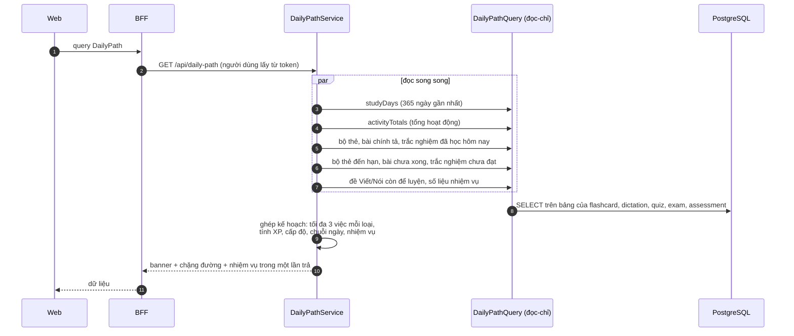
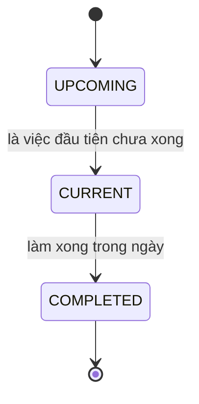

# Lộ trình hằng ngày

Module backend: `progress`. Màn: `/study/daily-path` và thẻ "Học tiếp" ở trang chủ học viên.

## Ý tưởng chính: tính lại mỗi lần đọc, không lưu

Module `progress` **không có bảng nào để ghi**. Lộ trình, XP, cấp độ, chuỗi ngày và nhiệm vụ đều được tính từ dữ liệu
hoạt động thật mỗi lần mở màn. Không có sổ điểm riêng có thể lệch khỏi những gì người học đã làm, và màn không bao giờ
"chưa cập nhật".

## Chặng đường hôm nay

Mỗi chặng có loại (`FLASHCARD_REVIEW`, `DICTATION`, `QUIZ`, `WRITING`, `SPEAKING`) và trạng thái:

Nguồn của từng loại:

| Loại                  | Lấy từ                                                |
| --------------------- | ----------------------------------------------------- |
| `FLASHCARD_REVIEW`    | Bộ thẻ có thẻ đến hạn ôn (`flashcard_reviews.due_at`) |
| `DICTATION`           | Bài chính tả đã mở nhưng chưa xong                    |
| `QUIZ`                | Bài trắc nghiệm chưa đạt                              |
| `WRITING`, `SPEAKING` | Đề Viết/Nói đã xuất bản còn để luyện                  |

## XP và cấp độ

| Hoạt động                                      | XP  |
| ---------------------------------------------- | --- |
| Ôn một thẻ                                     | 2   |
| Chép một câu chính tả                          | 5   |
| Nộp một bài trắc nghiệm                        | 20  |
| Nộp một bài Viết/Nói (lần nộp hợp lệ đầu tiên) | 20  |
| Chấm xong một lượt thi                         | 100 |

Cấp 1 cần 200 XP, mỗi cấp sau cần thêm 100 XP so với cấp trước (200, 300, 400, ...). Tăng tuyến tính để cấp tiếp theo
luôn trong tầm với. Chấm lại, thử lại hay mở lại báo cáo không cộng thêm XP; bản nháp không tính XP lẫn chuỗi ngày.

## Chuỗi ngày và nhiệm vụ

- **Chuỗi ngày:** số ngày liên tiếp có bất kỳ hoạt động nào, kể cả làm bài thi. "Một ngày" tính theo múi giờ
  `Asia/Ho_Chi_Minh`.
- **Nhiệm vụ hằng ngày:** ôn hết thẻ đến hạn, đạt một bài trắc nghiệm, chép 10 câu, học đủ 7 ngày trong tuần.
