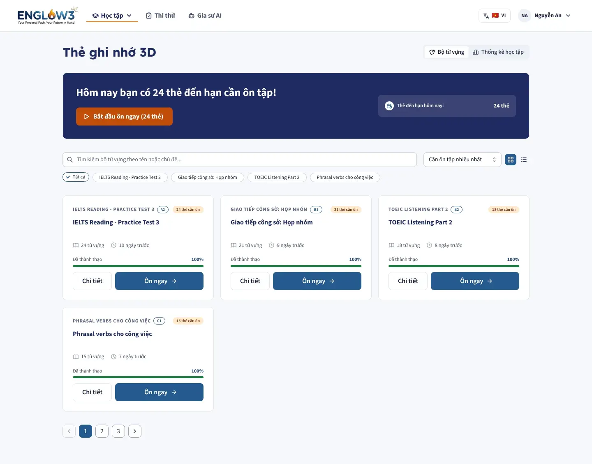
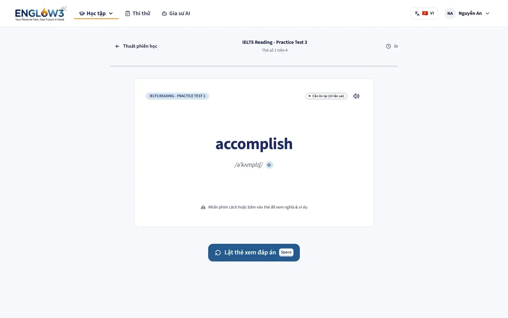
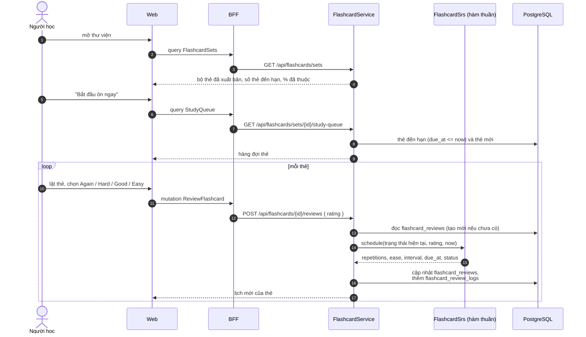
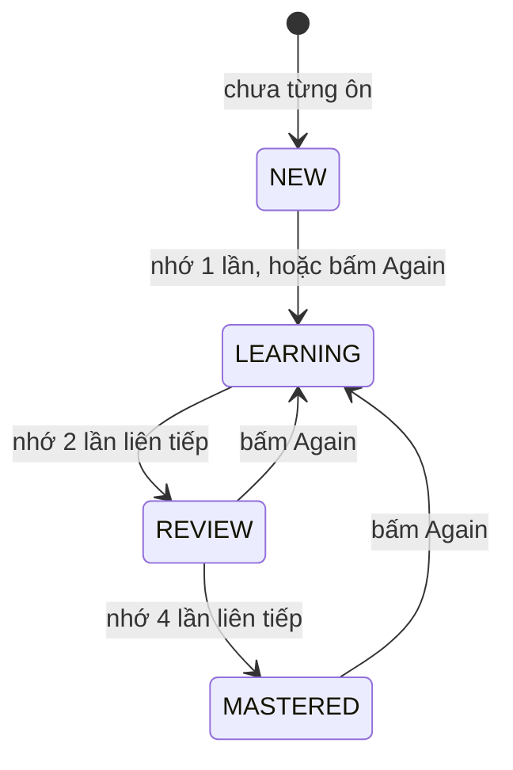

# Flashcard

Module backend: `flashcard`. Màn: `/study/flashcards`, `/study/flashcards/[setId]`, `/study/flashcards/[setId]/study`.

| Thư viện bộ thẻ                          | Ôn tập                                        |
| ---------------------------------------- | --------------------------------------------- |
|  |  |

## Luồng ôn tập

## Thuật toán lặp lại ngắt quãng (SM-2)

`FlashcardSrs` là hàm thuần của (trạng thái hiện tại, nút bấm, thời điểm), nên được test đủ mọi trường hợp mà không cần
cơ sở dữ liệu.

| Nút   | Điểm SM-2 | Ảnh hưởng tới ease | Thẻ quay lại                                         |
| ----- | --------- | ------------------ | ---------------------------------------------------- |
| Again | 2         | Giảm 0,32          | Sau 10 phút, trong cùng buổi học; đặt lại số lần nhớ |
| Hard  | 3         | Giảm 0,14          | Theo khoảng tiếp theo                                |
| Good  | 4         | Giữ nguyên         | Theo khoảng tiếp theo                                |
| Easy  | 5         | Tăng 0,10          | Theo khoảng tiếp theo                                |

Khoảng cách ôn: lần nhớ thứ nhất 1 ngày, lần thứ hai 6 ngày, từ lần thứ ba nhân với hệ số ease (làm tròn lên, tối đa
100 năm). Ease bắt đầu 2,5 và không xuống dưới 1,3.

## Thống kê

`GET /api/flashcards/stats` trả số thẻ theo trạng thái, lịch sử ôn theo ngày và chuỗi ngày ôn, tính từ
`flashcard_review_logs`. Tab "Thống kê học tập" trên màn thư viện hiển thị dữ liệu này.

## Nội dung

Staff soạn bộ thẻ hoặc import file do data pipeline sinh (`POST /api/admin/flashcards/import`, có chạy thử trước). Bộ
thẻ đi qua quy trình [soạn và duyệt](10-soan-duyet-noi-dung.md) trước khi learner thấy. Audio của thẻ nằm trong bucket
`learning`.
