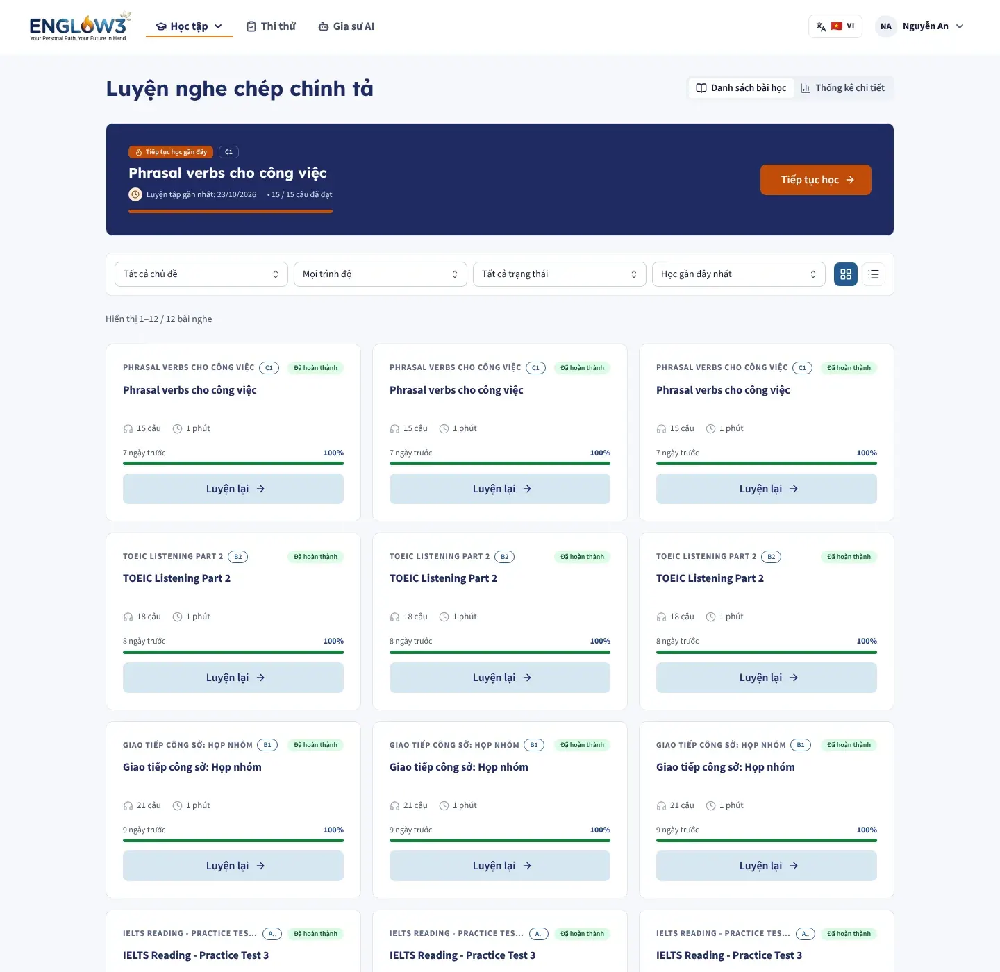
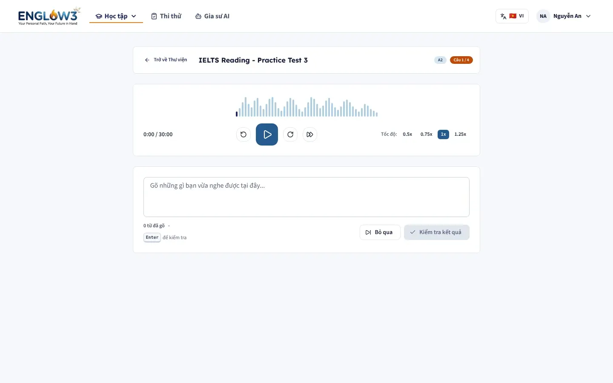
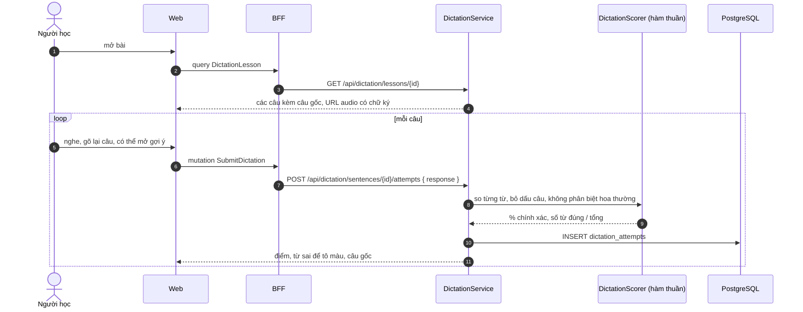
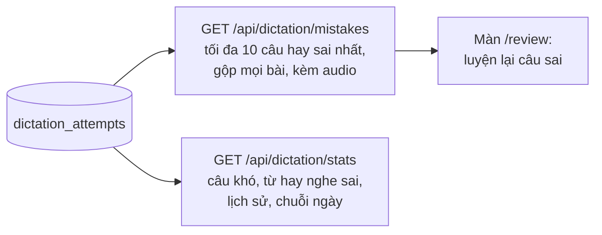

# Chính tả (nghe chép)

Module backend: `dictation`. Màn: `/study/dictation`, `/study/dictation/[lessonId]`, `/study/dictation/[lessonId]/review`.

| Danh sách bài                            | Làm bài                                    |
| ---------------------------------------- | ------------------------------------------ |
|  |  |

Một bài (lesson) gồm nhiều câu. Mỗi câu có đoạn audio (cắt từ một file chung bằng `audio_start_ms`, `audio_end_ms`),
câu gốc, bản dịch tiếng Việt và các mức gợi ý (số từ, chữ cái đầu, hiện một từ, hiện một phần câu).

## Luồng làm bài

- Một câu được tính là **đã qua khi đạt từ 80%**. Ngưỡng này nằm ở một chỗ (`DictationScorer.COMPLETION_THRESHOLD`) và
  được dùng chung cho tiến độ bài, màn thống kê và lộ trình hằng ngày, nên ba nơi không bao giờ nói khác nhau.
- Câu gốc được gửi kèm để màn hình tô đúng/sai ngay khi gõ xong, nhưng **điểm được lưu luôn do server tính** từ câu
  người học gửi lên.
- Mỗi lượt gõ là một dòng mới trong `dictation_attempts`; không ghi đè lượt cũ.

## Câu hay sai và thống kê

"Câu hay sai" tính trên toàn bộ các bài, vì câu hỏi "mình hay sai gì" là về người học, không về một bài cụ thể. Danh
sách này **không** kèm câu gốc: người học phải chép lại và gửi lên server, nhờ vậy lượt luyện lại được ghi nhận.

## Nội dung

Staff soạn bài, upload audio (`/api/admin/dictation/media`) hoặc import file do data pipeline sinh
(`POST /api/admin/dictation/import`). Bài đi qua quy trình [soạn và duyệt](10-soan-duyet-noi-dung.md).
