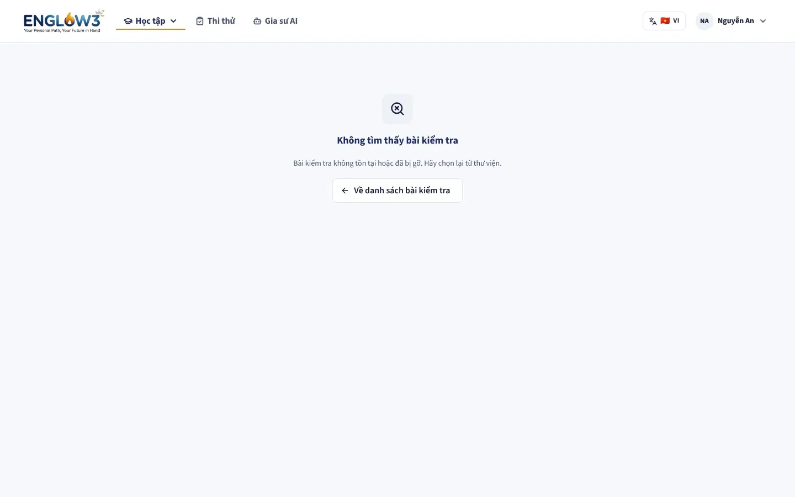
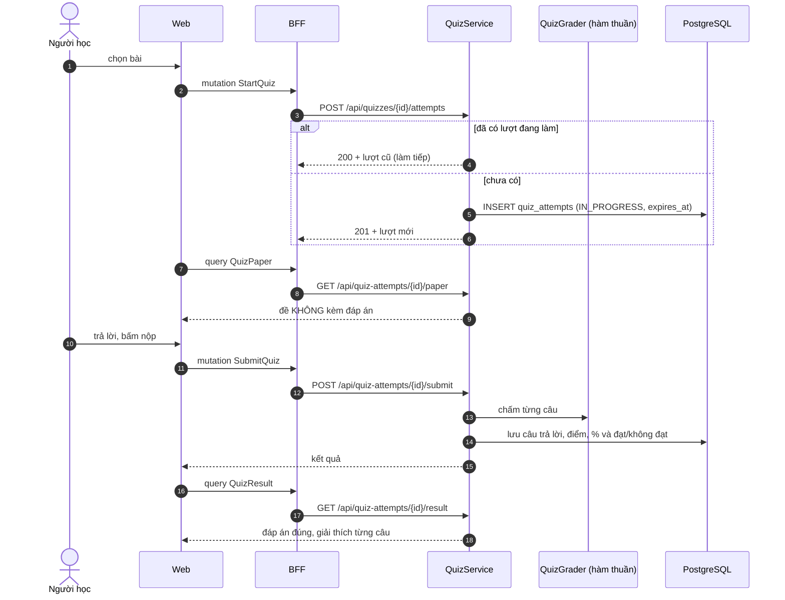
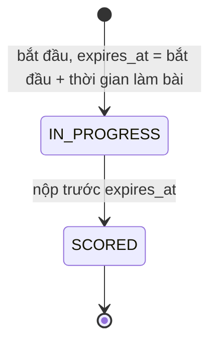

# Trắc nghiệm

Module backend: `quiz`. Màn: tab "Thử thách trắc nghiệm" trong `/study/daily-path` và `/study/quiz/[quizId]`.

## Năm dạng câu hỏi

| Dạng              | Người học làm gì                 | Dữ liệu đáp án                                  |
| ----------------- | -------------------------------- | ----------------------------------------------- |
| `MULTIPLE_CHOICE` | Chọn một đáp án                  | `quiz_question_options`                         |
| `FILL_BLANK`      | Điền từ vào chỗ trống            | Token `ACCEPTED_ANSWER` (nhiều cách viết đúng)  |
| `REWRITE`         | Viết lại câu bằng các từ cho sẵn | Token `WORD_BANK`, `CORRECT_WORD`               |
| `REORDER`         | Sắp xếp các mảnh thành câu đúng  | Token `SCRAMBLED`, `CORRECT_ORDER`              |
| `MATCHING`        | Nối vế trái với vế phải          | `quiz_question_pairs`, trộn theo thứ tự cố định |

`QuizGrader` là hàm thuần chấm cả năm dạng, so sánh không phân biệt hoa thường và gộp khoảng trắng: gõ đúng từ là
đúng, không bắt người học khớp cả cách viết hoa hay dấu cách.

## Luồng làm bài

Sau `expires_at`, server từ chối cả lấy đề lẫn nộp bài (`QUIZ_ATTEMPT_EXPIRED`). Vì vậy web tự nộp ngay khi đồng hồ về 0. Enum có trạng thái `EXPIRED` nhưng luồng hiện tại không chuyển lượt nào sang đó.

- **Đạt** khi phần trăm điểm từ `passing_score_percent` của bài trở lên. Ngưỡng là phần trăm chứ không phải điểm thô,
  nên thêm câu vào bài không làm lệch ngưỡng.
- **Đề và đáp án là hai bản khác nhau.** Đề gửi lúc đang làm không chứa đáp án; mỗi đối tượng (người làm bài, người xem
  kết quả, người soạn) nhận một bản dữ liệu riêng, không phải một bản chung bị xoá bớt trường.
- Sau khi có kết quả, người học có thể hỏi [gia sư AI](09-gia-su-ai.md) về một câu cụ thể; gia sư nhận ngữ cảnh câu đó qua
  `quiz.api.SubmittedQuizContextReader`.
