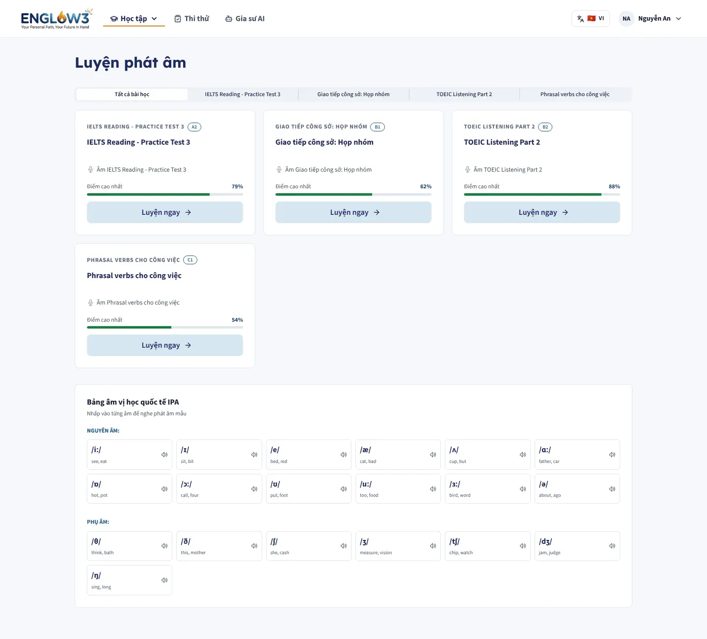
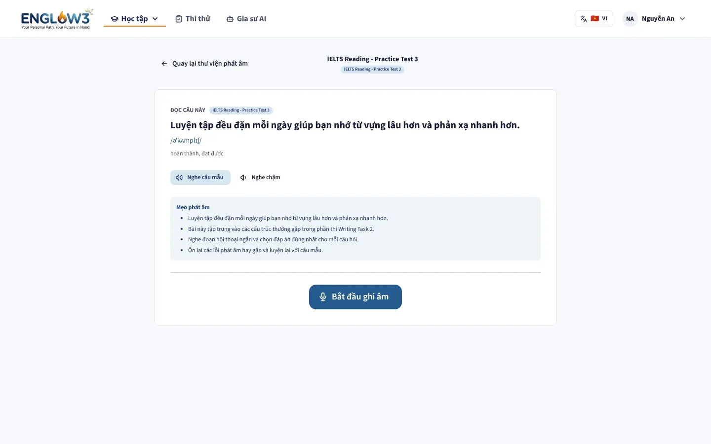
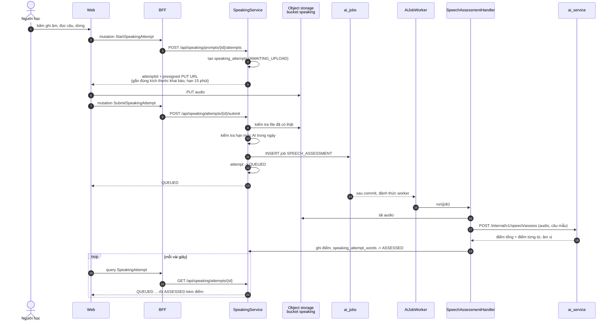
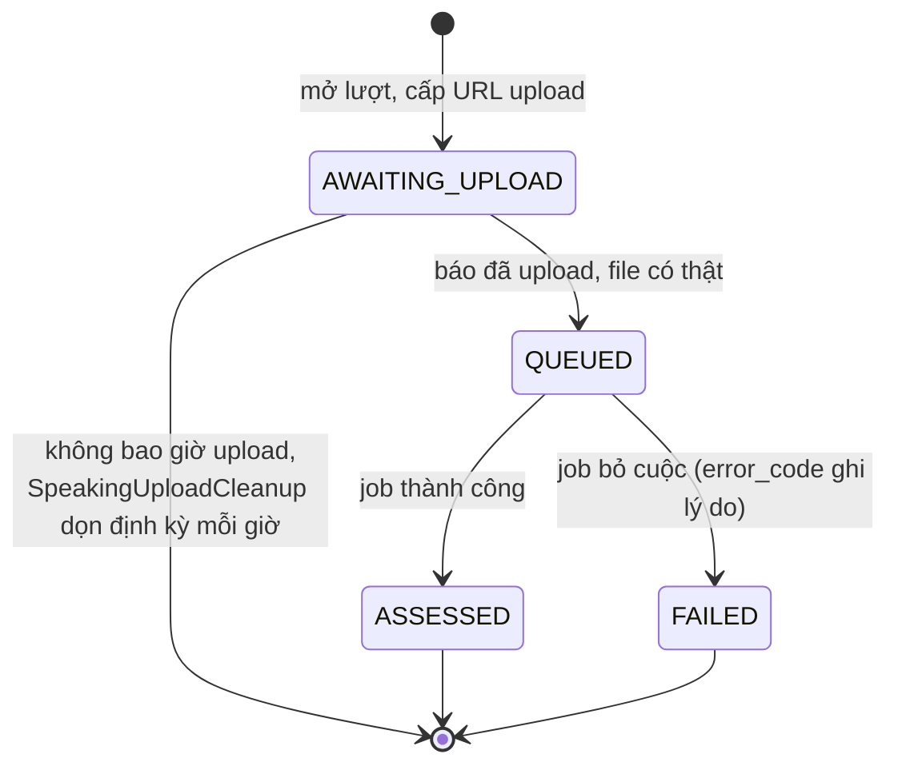

# Luyện phát âm

Module backend: `speaking` (dùng `ai`). Màn: `/study/pronunciation`, `/study/pronunciation/[lessonId]`.

| Danh sách câu luyện                     | Luyện một câu                           |
| --------------------------------------- | --------------------------------------- |
|  |  |

Người học đọc to một câu mẫu. Hệ thống chấm độ chính xác, độ trôi chảy, độ đầy đủ, ngữ điệu và điểm phát âm tổng, tới
từng từ.

## Luồng ghi âm và chấm

Ghi âm cần ba lời gọi thay vì một lần upload: audio đi **thẳng từ trình duyệt lên object storage**, không qua web, BFF
hay backend.

Polling thay vì giữ kết nối: một người chờ vài giây để có một điểm không đáng để giữ, cân bằng tải và nối lại một
socket.

## Kết quả

| Chỉ số                   | Ý nghĩa                                             |
| ------------------------ | --------------------------------------------------- |
| `accuracy_percent`       | Phát âm đúng từng âm                                |
| `fluency_percent`        | Trôi chảy, ngắt nghỉ                                |
| `completeness_percent`   | Đọc đủ các từ trong câu mẫu                         |
| `prosody_percent`        | Ngữ điệu, trọng âm                                  |
| `pronunciation_percent`  | Điểm tổng                                           |
| `recognized_text`        | Câu hệ thống nghe được                              |
| `speaking_attempt_words` | Điểm và loại lỗi của từng từ (đọc sai, thiếu, thừa) |

Với nhà cung cấp Azure, các chỉ số trên là điểm chấm thật tới âm vị. Với Whisper, fluency và pronunciation là ước lượng
(xem [6. AI](../06-ai.md#hai-nhà-cung-cấp-chấm-phát-âm)).
