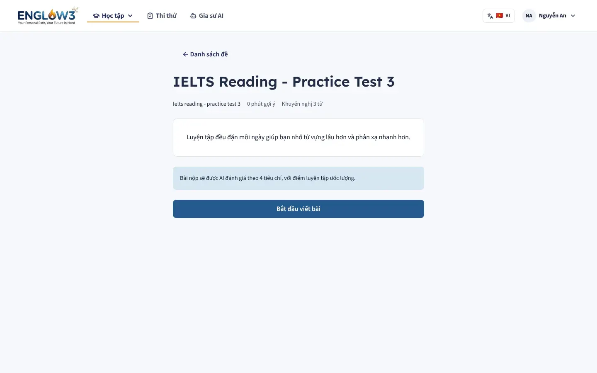
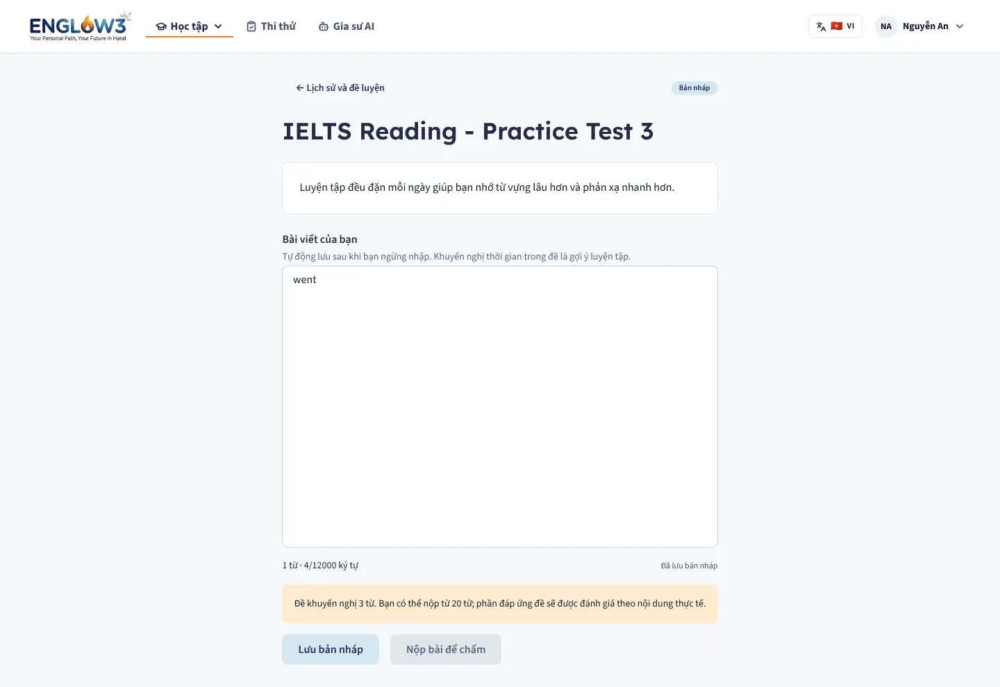
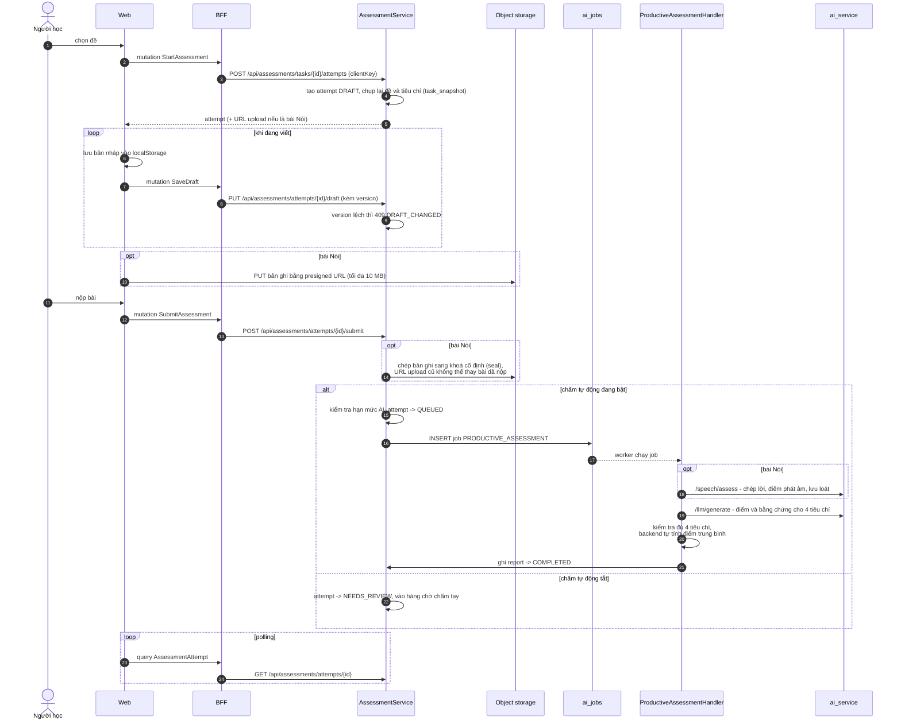
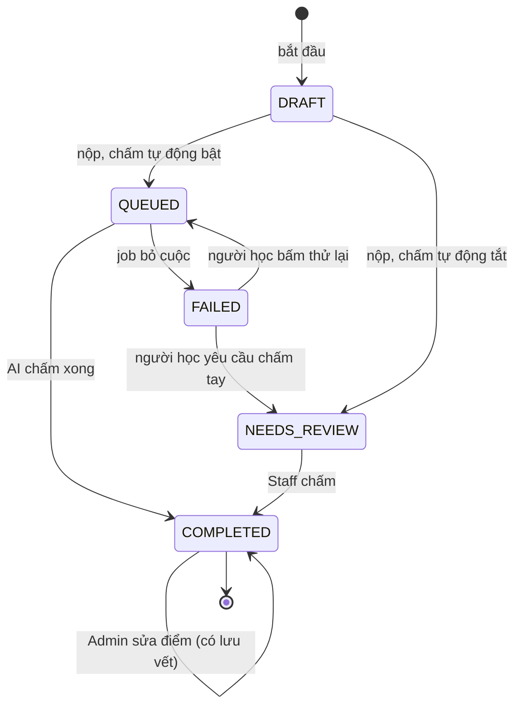
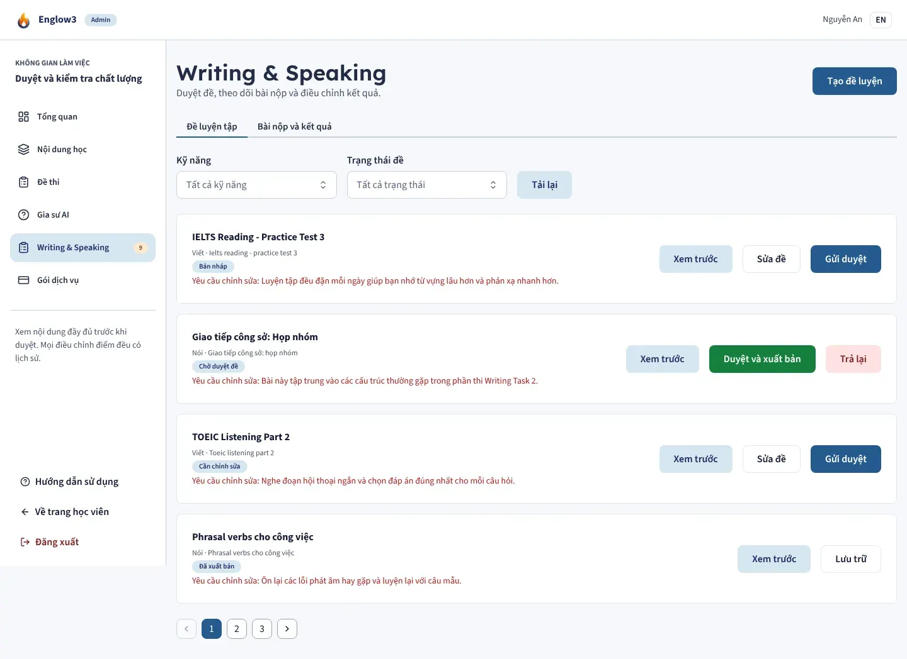

# Luyện Viết và Nói

Module backend: `assessment` (dùng `ai`). Màn: `/study/writing`, `/study/speaking`, `/study/assessments`. Khu chấm bài của
Staff/Admin: `/admin/assessments`.

Khác với [luyện phát âm](06-phat-am.md) (đọc lại một câu mẫu), đây là bài làm tự do: viết một đoạn văn hoặc nói về một
chủ đề, được chấm theo **4 tiêu chí** như bài thi thật.

| Làm bài Viết                        | Báo cáo kết quả                                |
| ----------------------------------- | ---------------------------------------------- |
|  |  |

## Luồng làm bài

## Những điểm thiết kế quan trọng

- **Chụp đề khi bắt đầu.** Attempt lưu bản sao đề và tiêu chí (`task_snapshot`); đề đã xuất bản không sửa được. Bài mẫu
  chỉ hiện sau khi có kết quả.
- **Bản nháp hai lớp.** Lưu trên server có kiểm tra version (hai tab cùng sửa thì tab cũ bị từ chối), cộng bản sao trong
  `localStorage` để mất mạng không mất bài. Bài đã nộp không sửa được.
- **Chặn kết quả cũ.** Mỗi lần gửi chấm tăng `grading_revision`. Kết quả về với revision cũ (ví dụ từ lần chấm trước khi
  người học bấm thử lại) bị bỏ qua.
- **Điểm do backend tính.** LLM trả điểm từng tiêu chí kèm bằng chứng; backend kiểm tra đủ và tự tính trung bình, gắn
  nhãn "điểm luyện tập ước lượng".
- **Chấm tay có lưu vết.** Staff chấm, Admin sửa điểm đều ghi một dòng `assessment_reviews` kèm báo cáo trước đó và ghi
  chú của người chấm.
- **Thông báo.** Khi có kết quả, người học thấy thông báo (`/api/assessments/notifications`), đánh dấu đã đọc riêng
  từng bài.

## Phân quyền

| Vai trò | Được làm                                                       |
| ------- | -------------------------------------------------------------- |
| Learner | Xem đề đã xuất bản, làm bài, xem bài và báo cáo của chính mình |
| Staff   | Soạn đề, gửi duyệt, chấm bài thuộc đề mình soạn                |
| Admin   | Duyệt, từ chối, lưu trữ đề; sửa điểm bài đã chấm               |

