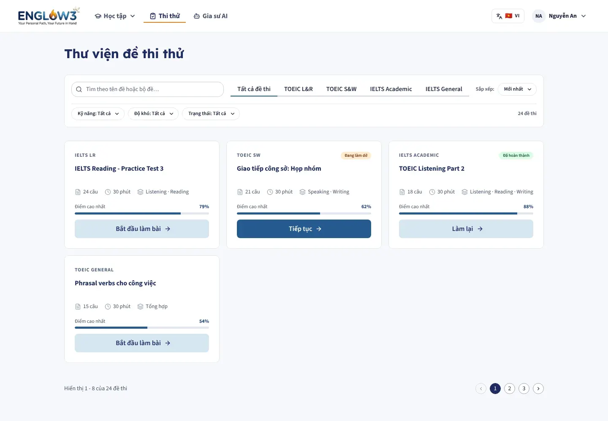
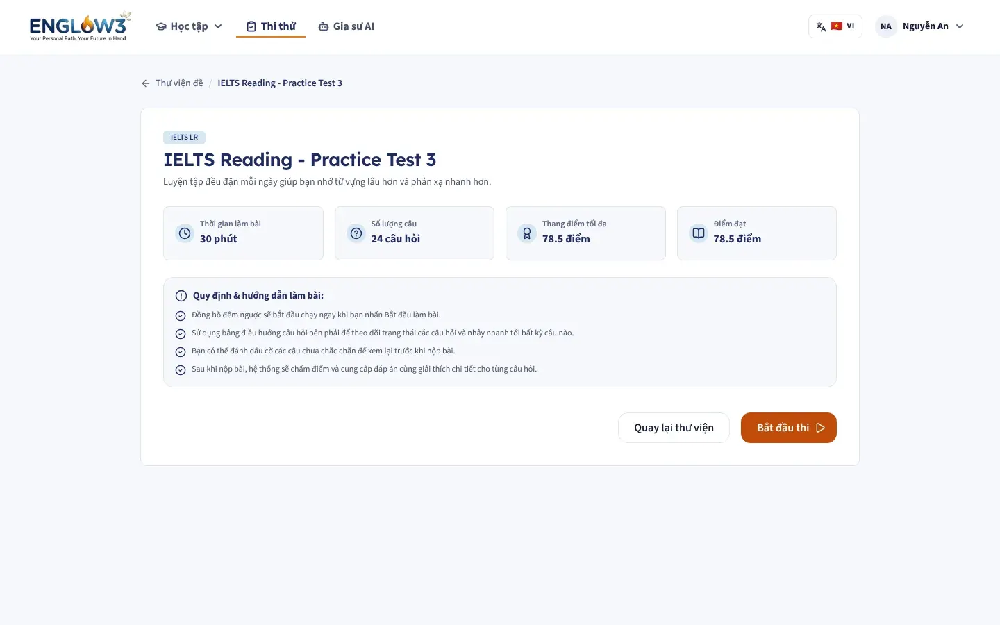
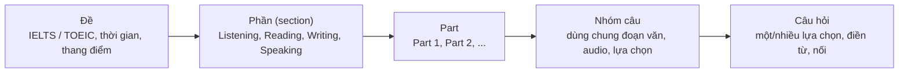
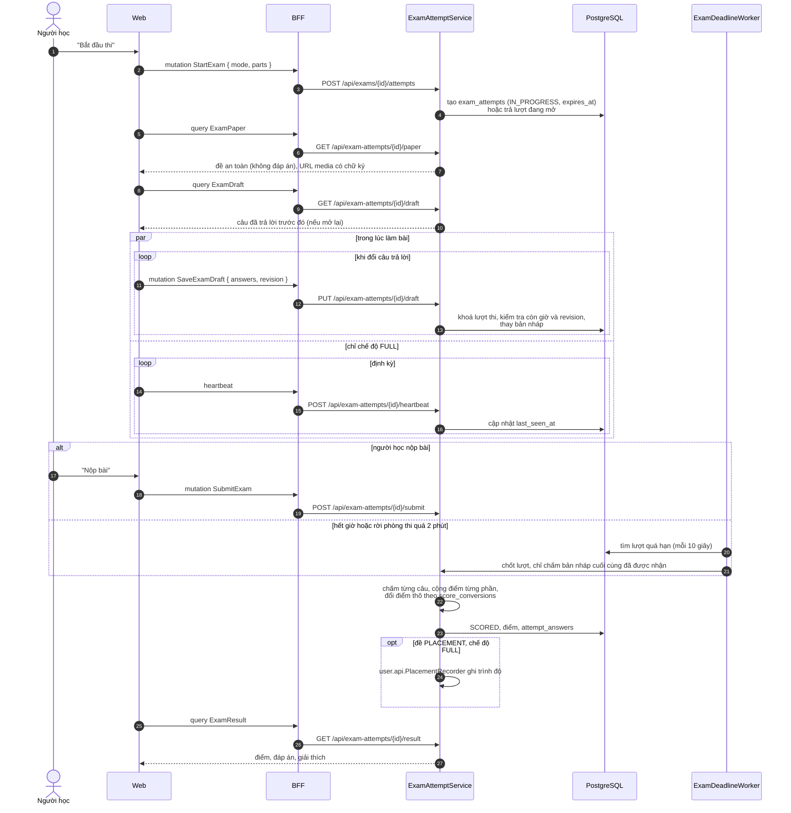
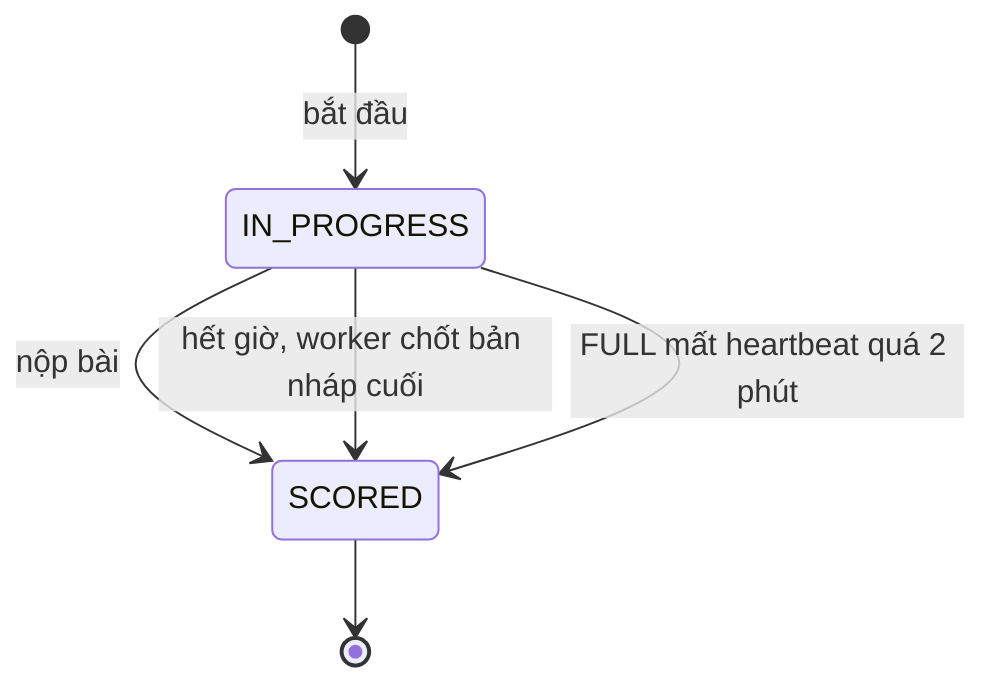
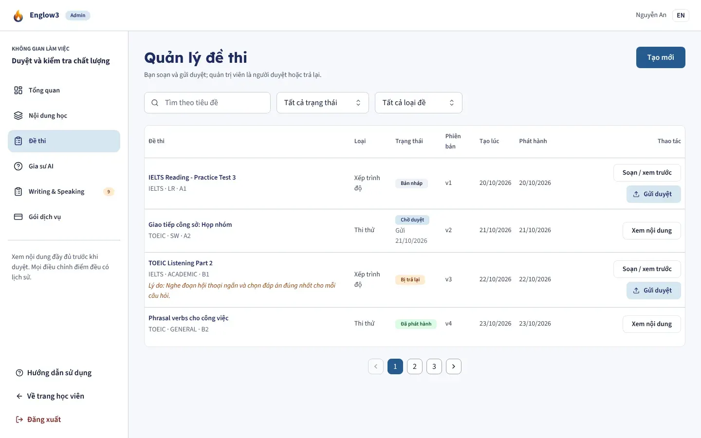

# Thi thử

Module backend: `exam`. Màn: `/exams` (thư viện đề), `/exams/[id]` (tổng quan và phòng thi).

| Thư viện đề                            | Tổng quan đề                                    |
| -------------------------------------- | ----------------------------------------------- |
|  |  |

## Cấu trúc một đề

- Loại đề: `MOCK` (thi thử) và `PLACEMENT` (xếp lớp khi onboarding).
- Biến thể chứng chỉ: TOEIC `LR` (nghe đọc), `SW` (nói viết); IELTS `ACADEMIC`, `GENERAL`.
- `score_conversions` đổi điểm thô sang thang điểm chứng chỉ (band IELTS, điểm TOEIC).

## Hai chế độ làm bài

| Chế độ     | Làm gì                                                  | Thời gian                      |
| ---------- | ------------------------------------------------------- | ------------------------------ |
| `FULL`     | Cả đề, như thi thật                                     | Thời gian của đề, có heartbeat |
| `PRACTICE` | Chọn một số part (lấy từ `GET /api/exams/{id}/outline`) | Người học tự chọn              |

Mỗi người chỉ có **một lượt đang mở cho mỗi đề và mỗi chế độ**. Lượt `FULL` và `PRACTICE` của cùng một đề mở song song
được; mở lại một chế độ không ảnh hưởng chế độ kia.

## Luồng làm bài

Enum có thêm `EXPIRED`, nhưng luồng hiện tại không dùng: lượt quá hạn luôn được chốt và chấm thành `SCORED`.

## Quy tắc chống gian lận và mất bài

- **Giờ do server tính.** Bản nháp gửi sau `expires_at` bị từ chối; câu trả lời đến muộn không bao giờ vào bài được chấm.
- **Bản nháp có revision.** Mỗi lần lưu khoá lượt thi và kiểm tra revision, nên hai tab cùng làm không ghi đè lẫn nhau.
- **Tắt trình duyệt vẫn được chấm.** Worker chạy mỗi 10 giây chấm bản nháp cuối cùng của lượt đã hết giờ. Đọc kết quả của
  một lượt đã hết giờ cũng tự chốt lượt đó.
- **Rời phòng thi.** Lượt `FULL` không còn heartbeat quá 2 phút bị coi là đã kết thúc; lưu nháp không thể "hồi sinh" lượt
  đó.
- **Xem trước không bắt đầu tính giờ.** `GET /api/exams/{id}/active-attempts` chỉ đọc, không mở lượt mới.

## Soạn đề

Staff soạn đề trong `/admin/exams` (API `/api/admin/exams`, cấu trúc đề đầy đủ qua `/authoring`), tìm câu có sẵn trong
ngân hàng câu hỏi (`/api/admin/question-bank`). Đề đi qua quy trình [soạn và duyệt](10-soan-duyet-noi-dung.md); khi
xuất bản, entity `Exam` kiểm tra số phần, số câu và tổng điểm khớp nhau.

