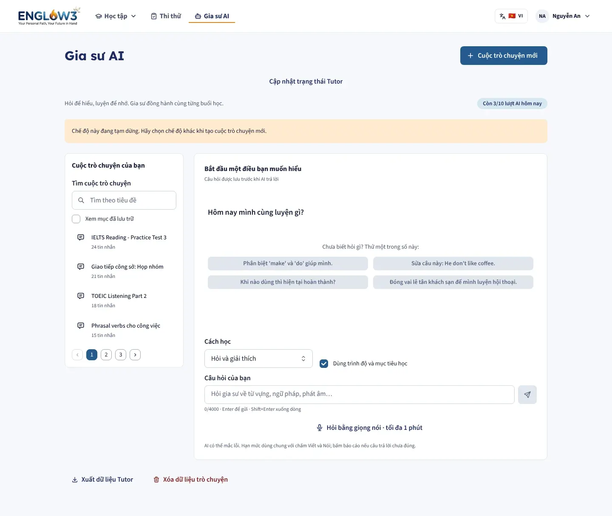
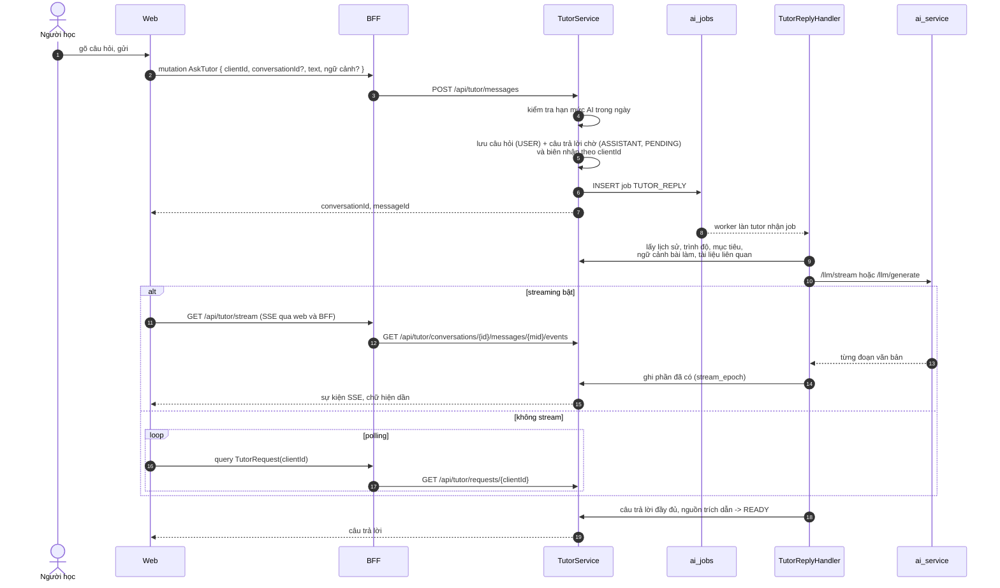
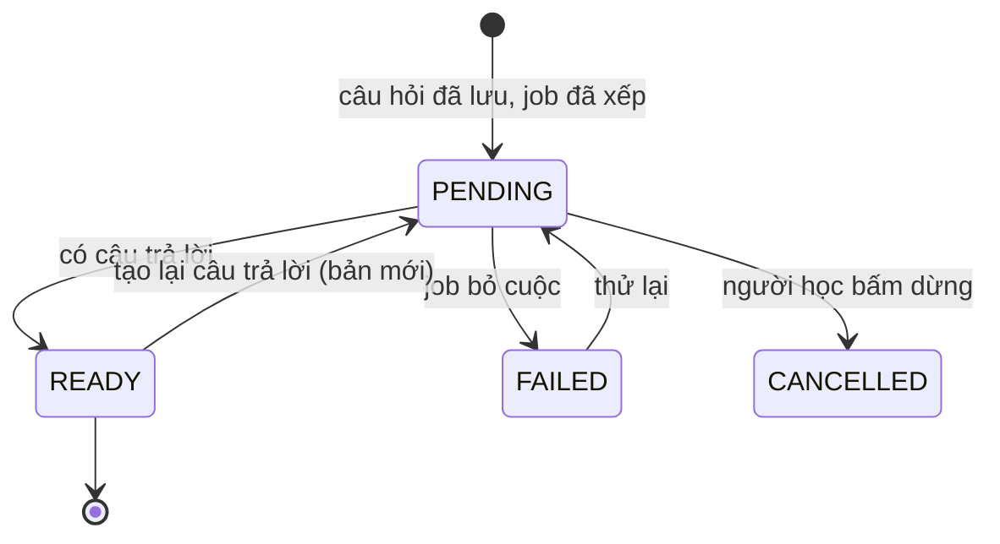
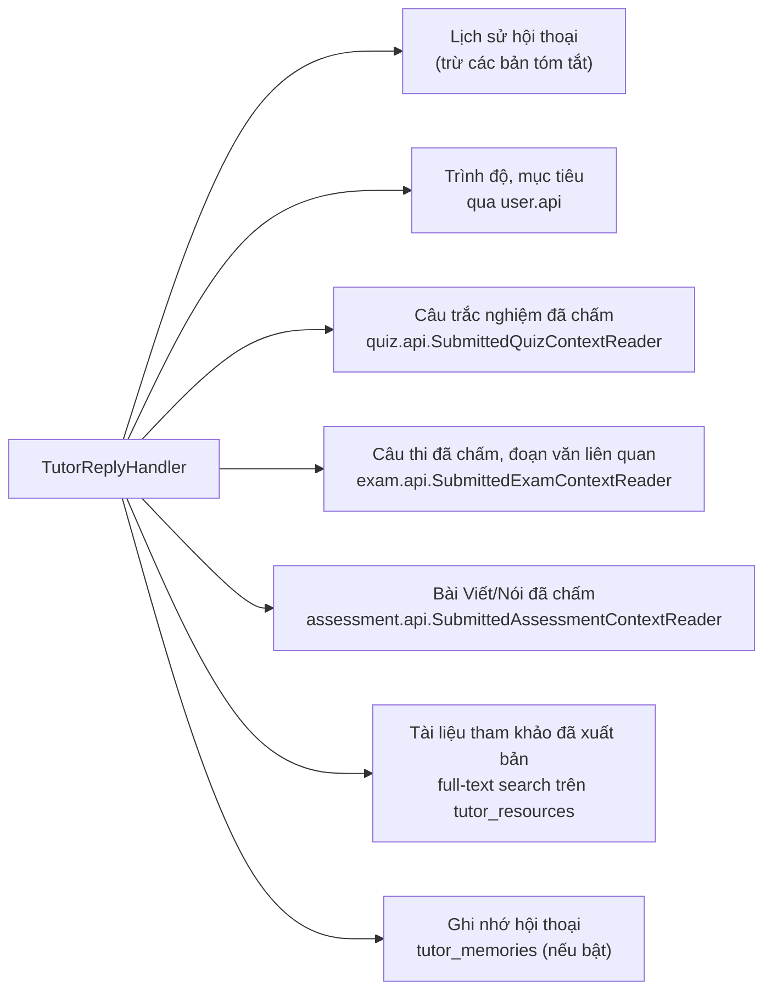
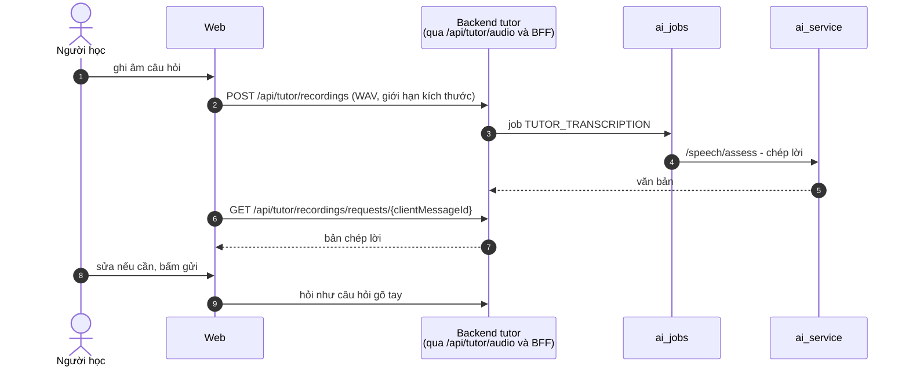
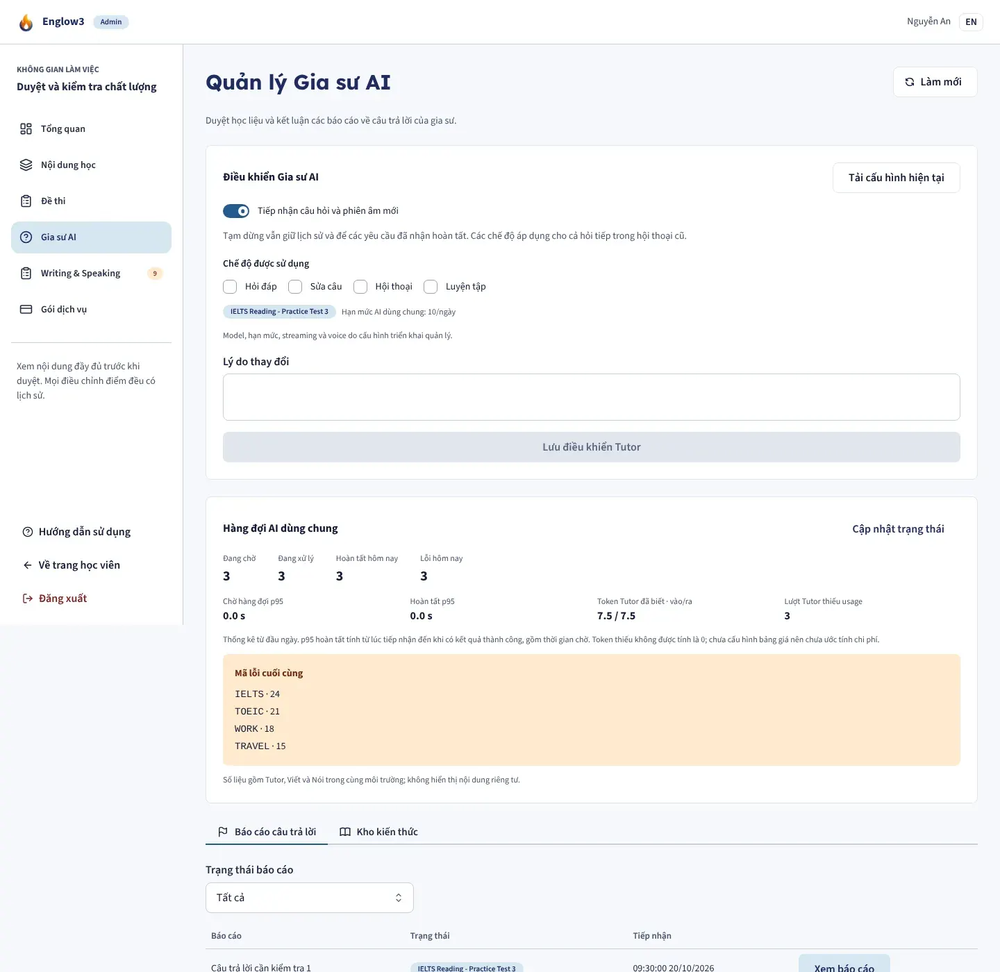

# Gia sư AI

Module backend: `tutor` (dùng `ai`). Màn: `/ai-tutor`. Khu quản trị: `/admin/ai-tutor`.

Người học hỏi bằng chữ hoặc giọng nói về tiếng Anh, có thể gắn câu hỏi với một câu trắc nghiệm, một câu thi hoặc một bài
Viết/Nói đã chấm. Gia sư trả lời bằng LLM, có trích dẫn tài liệu tham khảo đã được duyệt.

## Nguyên tắc: hỏi đồng bộ, trả lời bất đồng bộ

Câu hỏi được **lưu trước khi hỏi bất kỳ nhà cung cấp nào**, nên nhà cung cấp lỗi cũng không làm mất điều người học đã
gõ. Câu trả lời đến sau qua hàng đợi AI.

Gửi lại cùng `clientId` (ví dụ mạng chập chờn khiến trình duyệt gửi hai lần) trả về đúng lượt đã tạo, không tạo câu
hỏi trùng.

## Những gì gia sư được biết

- Mỗi module sở hữu dữ liệu tự kiểm tra **người hỏi là chủ bài làm và bài đã được chấm** trước khi đưa ngữ cảnh ra. Ngữ
  cảnh không chứa URL media riêng tư, điểm tiêu chí ẩn hay ghi chú riêng của người chấm.
- Hồ sơ và nội dung tài liệu được đặt trong phần ngữ cảnh không tin cậy, không bao giờ nằm trong chỉ dẫn hệ thống.
- Trích dẫn giữ đúng phiên bản tài liệu tại thời điểm trả lời, kể cả khi tài liệu được sửa sau đó.

## Các thao tác khác

| Thao tác                         | API                                                         |
| -------------------------------- | ----------------------------------------------------------- |
| Thử lại, tạo lại, dừng           | `POST .../messages/{mid}/retry`, `/regenerate`, `/cancel`   |
| Xem và chọn các bản trả lời      | `GET .../messages/{mid}/versions`, `POST .../select`        |
| Rẽ nhánh hội thoại từ một câu    | `POST .../messages/{mid}/branch`                            |
| Báo cáo câu trả lời sai          | `POST /api/tutor/conversations/{cid}/messages/{mid}/report` |
| Tóm tắt, xoá ghi nhớ             | `POST .../memory/summarize`, `DELETE .../memory`            |
| Lượng dùng trong ngày            | `GET /api/tutor/usage`                                      |
| Xuất, xoá toàn bộ dữ liệu gia sư | `GET /api/tutor/data/export`, `DELETE /api/tutor/data`      |

Sửa một câu hỏi đã gửi sẽ tạo hội thoại mới thay vì viết đè lịch sử.

## Hỏi bằng giọng nói

Bản chép lời **không tự thành câu hỏi**: người học phải xác nhận. File ghi âm tự xoá sau 24 giờ.

## Quản trị

| Vai trò | Được làm                                                                                                               |
| ------- | ---------------------------------------------------------------------------------------------------------------------- |
| Staff   | Soạn tài liệu tham khảo, gửi duyệt; xử lý báo cáo được giao                                                            |
| Admin   | Xuất bản, rút tài liệu; xem số liệu vận hành (độ trễ p95, mã lỗi, token); chỉnh chính sách (`/api/admin/tutor/policy`) |

Staff không bao giờ nhận được danh sách hội thoại của người học; chỉ thấy câu trả lời bị báo cáo được giao cho mình. Số
liệu vận hành không chứa nội dung câu hỏi hay câu trả lời.

Stream, ghi âm và ghi nhớ mặc định **tắt**, bật bằng `TUTOR_STREAMING_ENABLED`, `TUTOR_VOICE_ENABLED`,
`TUTOR_MEMORY_ENABLED` (xem `docs/tutor-release-runbook.md` của backend).
