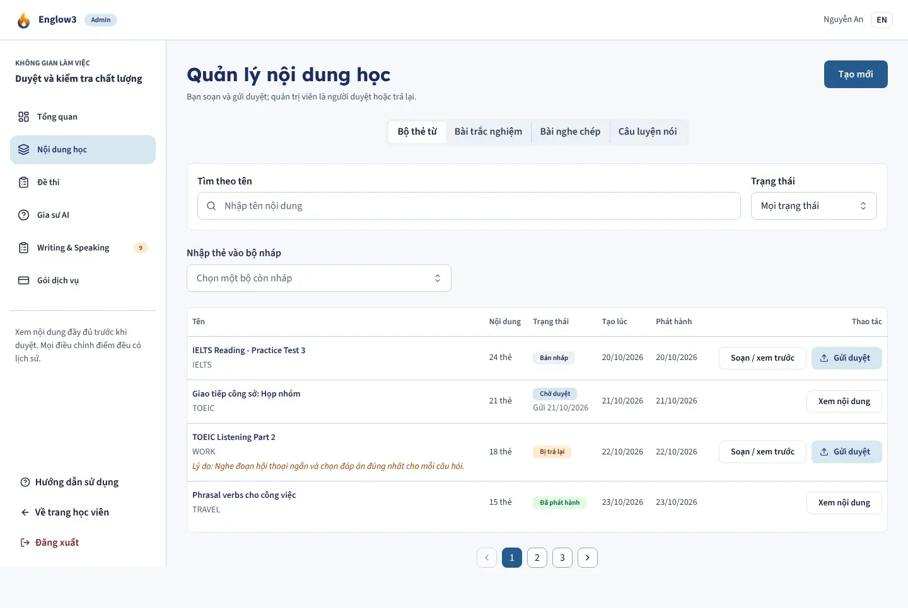
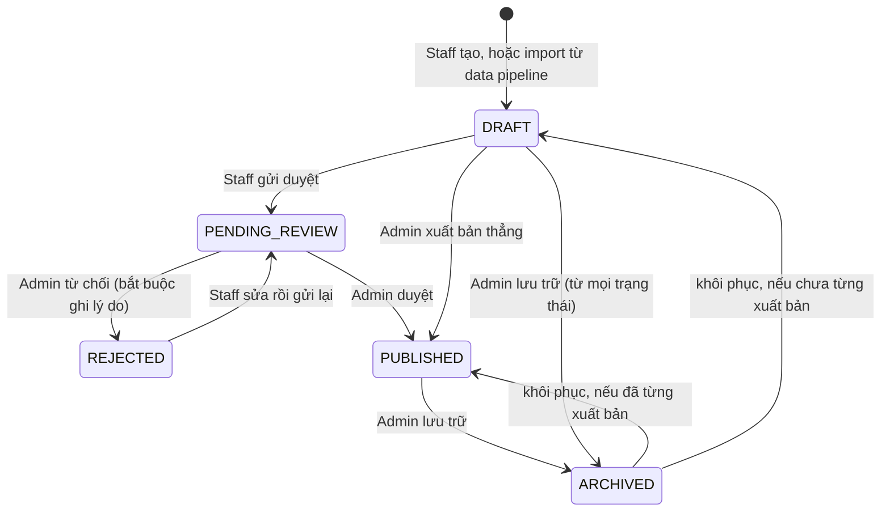
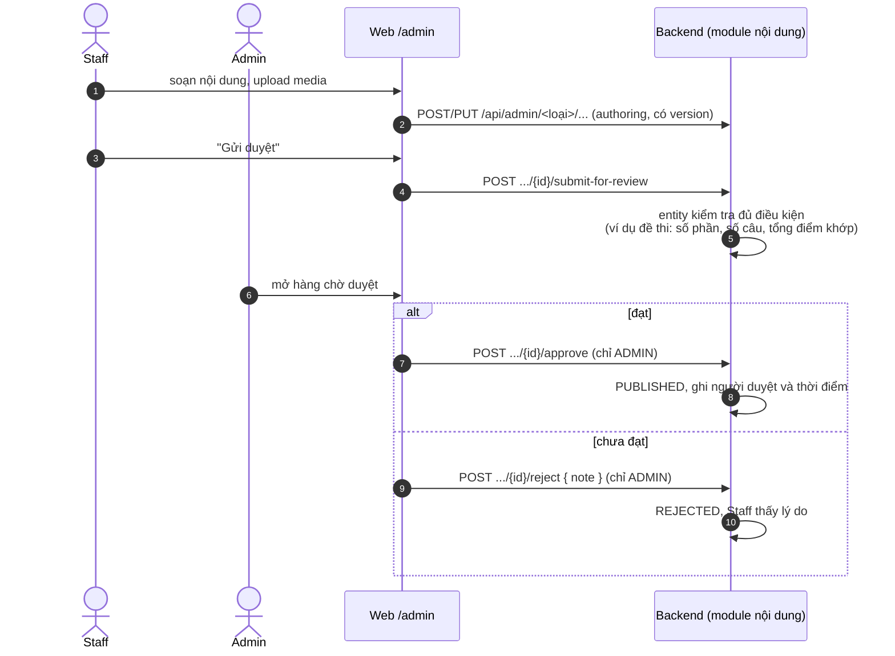
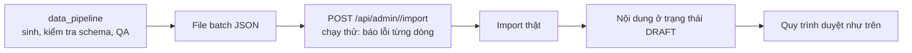

# Soạn và duyệt nội dung

Áp dụng cho mọi loại nội dung: đề thi (`exam`), bộ flashcard (`flashcard`), trắc nghiệm (`quiz`), bài chính tả
(`dictation`), câu luyện phát âm (`speaking`), đề Viết/Nói (`assessment`). Mỗi module có enum trạng thái riêng nhưng
cùng một quy trình. Màn: `/admin/content`, `/admin/exams`, `/admin/assessments`.

## Quy trình bốn mắt

Người soạn (Staff) không tự xuất bản được nội dung của mình; Admin duyệt. Learner chỉ thấy nội dung `PUBLISHED`.

## Phân quyền

- Mọi route `/api/admin/**` yêu cầu `STAFF` hoặc `ADMIN`.
- `approve`, `reject`, `publish`, `restore`, `archive` có thêm `@PreAuthorize("hasRole('ADMIN')")`.
- Staff chỉ thấy và chấm đề Viết/Nói do chính mình soạn.

## Soạn có version

Màn soạn (`/admin/content/editor/[kind]/[id]`) lưu toàn bộ cấu trúc qua endpoint `.../authoring` kèm số version. Hai
người cùng sửa thì người lưu sau bị từ chối thay vì âm thầm ghi đè.

## Import nội dung sinh tự động

Nội dung sinh tự động **luôn vào trạng thái nháp**: nội dung sinh ra chưa phải nội dung đã duyệt, và import thẳng vào
trạng thái xuất bản sẽ là đường vòng qua quy trình duyệt. Import câu hỏi đề thi từ CSV/XLSX/DOCX chưa có.
