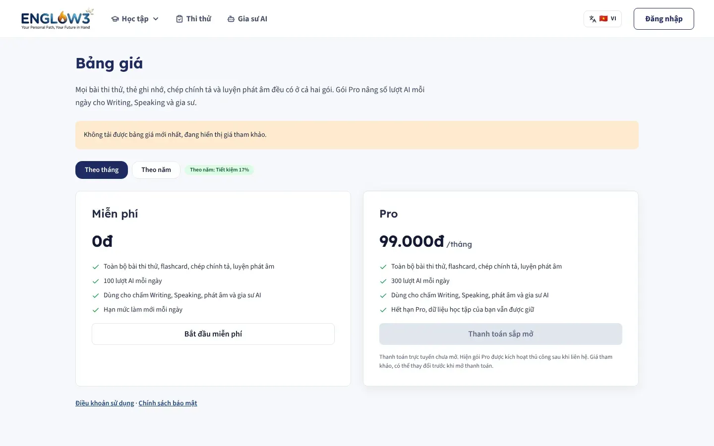
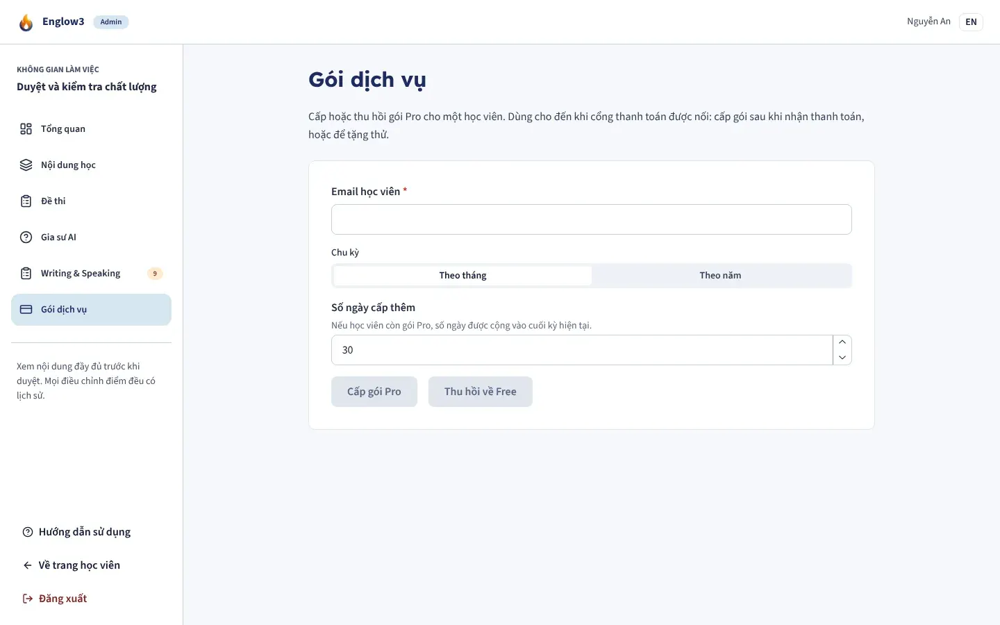
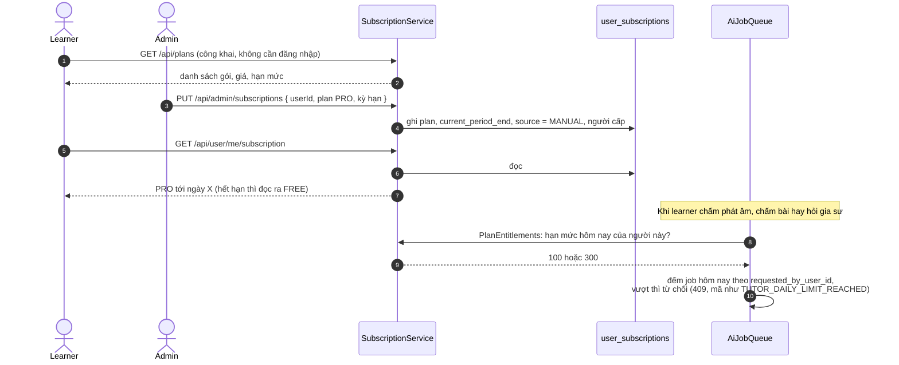

# Gói dịch vụ

Module backend: `subscription`. Màn: `/pricing` (bảng giá), tab trong `/profile`, `/admin/subscriptions` (cấp gói).

| Bảng giá                                | Cấp gói (Admin)                                 |
| --------------------------------------- | ----------------------------------------------- |
|  |  |

## Hai gói

| Gói    | Giá (mặc định)                | Lượt gọi AI mỗi ngày |
| ------ | ----------------------------- | -------------------- |
| `FREE` | 0                             | 100                  |
| `PRO`  | 99.000 đ/tháng, 990.000 đ/năm | 300                  |

Giá và hạn mức đặt bằng biến môi trường (`PLAN_PRO_PRICE_MONTHLY`, `PLAN_PRO_PRICE_YEARLY`, `PLAN_PRO_AI_DAILY_LIMIT`,
`AI_DAILY_REQUEST_LIMIT`). **Chưa kết nối cổng thanh toán**: giá chỉ để hiển thị, gói PRO do Admin cấp tay.

## Luồng

- **Hết hạn không cần ai ghi gì.** Gói được tính từ `current_period_end`; qua mốc đó là đọc ra `FREE`, nên gói đã hết hạn
  không bao giờ còn cấp quyền.
- Gói PRO bắt buộc có ngày hết hạn (ràng buộc trong cơ sở dữ liệu). Cấp tối đa 3650 ngày một lần.
- `DELETE /api/admin/subscriptions` thu hồi gói.
- Module khác chỉ hỏi hai câu nhỏ qua `subscription.api.PlanEntitlements` ("người này còn được gọi AI không"), không biết
  có những gói nào. Thêm gói hay đổi hạn mức chỉ sửa module này.
